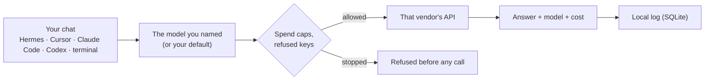

# Crossvet

**One chat, any model.** Talk to Claude, ChatGPT, Gemini, Grok or a model on your own machine from the chat you already use (Hermes, Cursor, Claude Code, Codex or a terminal), and switch models mid-conversation. You pick the model; Crossvet never picks it for you. Every answer shows which model gave it and what it cost, and spend caps stop a call before it is made.

[](https://github.com/j-zulick/crossvet/actions/workflows/ci.yml)
[](https://github.com/j-zulick/crossvet/actions/workflows/codeql.yml)
[](https://github.com/j-zulick/crossvet/releases/latest)
[](pyproject.toml)
[](LICENSE)

```
$ crossvet chat --model opus
you> Write a Python function parse_listing(s) that turns "2021 Toyota Tacoma SR5 - 34,210 mi - $31,995"
     into a dict with year, make, model, trim, miles and price. Code only.
anthropic:claude-opus-5-5> import re
     def parse_listing(s): ...                                  (43 lines; returns the right dict when run)
[anthropic:claude-opus-5-5 · 79 in / 763 out · $0.0156 · 6.4 s]

you> /model luna
now talking to openai:gpt-6-luna

you> Is a 2019 Honda CR-V with 48,000 miles low or high mileage for its age? Answer in one sentence.
openai:gpt-6-luna> At about 6,900 miles per year, a 2019 Honda CR-V with 48,000 miles has low mileage for its age.
[openai:gpt-6-luna · 490 in / 75 out · $0.0001 · 1.1 s]

you> /cost
This conversation:
  anthropic:claude-opus-5-5             1 answer  $0.0156
  openai:gpt-6-luna                     1 answer  $0.0001
```

A real session with the released build, from the [live run of 2026-11-26](docs/live-runs/2026-11-26.md), on tasks from used-car dealer work in Sarasota, Florida.

## Quick start

```bash
uv tool install "git+https://github.com/j-zulick/crossvet@v2.0.0"
mkdir -p ~/.config/crossvet && cp .env.example ~/.config/crossvet/.env   # then fill in the keys you have
crossvet start
```

`crossvet start` checks your keys without calling a model, prints the settings for each app below, and starts the server. Three dependencies (httpx, the MCP Python SDK, python-dotenv); Python 3.11 to 3.13. More: [docs/SETUP.md](docs/SETUP.md).

## Use it from the chat you already have

| Your chat | Connect once | Pick the model |
|---|---|---|
| **Hermes**, or any app that takes an OpenAI-style URL | Custom provider at `http://127.0.0.1:8787/v1` (keep `crossvet start` running) | The app's model menu (Crossvet lists your models at `/v1/models`), or type `/model NAME` |
| **Claude Code** | `claude mcp add --scope user crossvet -- crossvet mcp` | Ask it to use `ask_model` with the model you want |
| **Codex** | `codex mcp add crossvet -- crossvet mcp` | The same |
| **Cursor** | `crossvet start --no-serve` prints the `~/.cursor/mcp.json` entry | The same |
| A terminal | `crossvet chat --model opus` or `crossvet ask -m sol "..."` | `/model NAME` |

A model is named `provider:model` (`anthropic:claude-opus-5-5`, `openai:gpt-6.1-sol`, `google:...`, `xai:...`, `openrouter:vendor/model`, `ollama:...`) or by a short name you set (`opus`, `sonnet`, `sol`, `luna`). A request that names no model goes to your one `default_model`. `crossvet models` lists what you can name.

In any of them, typed as a whole message: `/model NAME` (switch), `/model` (show), `/models` (list), `/cost` (spend in this conversation and today).

## How it works



- **You choose, every time.** No routing, no fallback, no silent retries. If a call fails, the error names the model and you pick another.
- **Agents keep their tools.** Hermes and other agents send tools and tool results; Crossvet passes them through unchanged (Anthropic models through Anthropic's OpenAI-compatible endpoint, OpenAI models through OpenAI's Responses API, because OpenAI's current models refuse tools on chat completions).
- **Costs are visible and capped.** Each answer is priced from the vendor's list price (or OpenRouter's reported cost). A daily cap and a per-call worst-case cap stop a call before it is made. A provider that rejects your key or reports a billing problem is not called again until restart.
- **One local log.** Every question and answer, with model, tokens and cost, goes to one SQLite file (append-only), shared by every app: `crossvet log` and the `recent_turns` tool read it.

## Tested with real API calls

`tests/live/` calls the real APIs (`CROSSVET_LIVE=1 uv run pytest tests/live`). The [run of 2026-11-26](docs/live-runs/2026-11-26.md) passed all 13 checks with OpenAI and Anthropic keys, for **$0.023**:

- each of six models answered when named (Claude Opus, Sonnet and Haiku 5.5; GPT-6.1 Sol and Terra, GPT-6 Luna);
- through the server, the named model answered, `/model` switched the conversation to another vendor, the answer streamed, and `/cost` showed both;
- an agent's tool call went out and came back the way Hermes uses it (call `lookup_vin`, send the result, get the price) with Claude Sonnet, GPT-6.1 Sol and GPT-6 Luna;
- a per-call cap stopped a request before any model was called, and a rejected key was not called again;
- the MCP server, started the way Claude Code and Cursor start it, listed its three tools and answered.

The run found and fixed one real problem before release: OpenAI's current models refuse tools on chat completions. Not tested live yet: the Hermes and Cursor apps themselves (next release), Google, xAI, OpenRouter and local models.

## Project layout

About 1,800 lines of Python in seven modules, with 84 offline tests and 13 live ones.

| File | What it does |
|---|---|
| `src/crossvet/core.py` | The one path every request takes: resolve the name, check the caps, call, log |
| `src/crossvet/providers.py` | OpenAI, Anthropic, Google, xAI, OpenRouter, Ollama and any OpenAI-compatible server through one function |
| `src/crossvet/server.py` | The OpenAI-compatible server for Hermes and other chat apps |
| `src/crossvet/mcp_server.py` | Three MCP tools: `list_models`, `ask_model`, `recent_turns` |
| `src/crossvet/config.py` | Default model, short names, the model menu, prices, limits |
| `src/crossvet/store.py` | The local log |
| `src/crossvet/cli.py` | `crossvet start`, `chat`, `ask`, `models`, `cost`, `log`, `serve`, `mcp`, `init`, `doctor` |

## Documentation

[Using Crossvet](docs/CHAT.md) · [Setup](docs/SETUP.md) · [Architecture](docs/ARCHITECTURE.md) · [Design decisions](docs/DESIGN-DECISIONS.md) · [Security model](docs/SECURITY-MODEL.md) · [What stays stable](docs/STABILITY.md) · [Moving from 1.x](docs/MIGRATING.md) · [Changelog](CHANGELOG.md)

## License

MIT. See [LICENSE](LICENSE) and [NOTICES.md](NOTICES.md).
