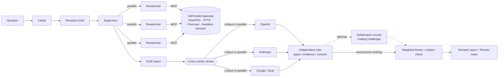

# Crossvet

[](https://github.com/j-zulick/crossvet/actions/workflows/ci.yml) [](https://github.com/j-zulick/crossvet/releases/latest) [](LICENSE) [](.python-version)

**AI research and chat whose answers are checked by models from other AI vendors, with every check that decides an outcome written in code.**

One model checking its own work shares its blind spots, and LLM judges favor their own output and confident wording. Crossvet puts models from different vendors against each other and lets code, not a model's say-so, decide what stands: a cited URL must appear in the research notes, evidence that overrules a finding must be a quote found verbatim in the notes, and debate stops by rule. Designed and built by [Joseph Zulick](https://github.com/j-zulick).

## Quick start

```bash
uv tool install "git+https://github.com/j-zulick/crossvet@v0.2.0"   # puts `crossvet` on your PATH (Python 3.11–3.13)
mkdir my-research && cd my-research                                   # .env and run files live in this folder
crossvet demo                                                         # a one-minute tour, free
```

No uv? `pip install "git+https://github.com/j-zulick/crossvet@v0.2.0"` in a virtual environment works too. Each [release](https://github.com/j-zulick/crossvet/releases) also carries the wheel. Working from a clone: [docs/SETUP.md](docs/SETUP.md).

| You want to | Run | Needs |
|---|---|---|
| See what it does first | `crossvet demo` | Nothing: no keys, no network, no cost |
| Check a page for hidden instructions aimed at AI | `crossvet scan https://example.com/pricing` | Nothing: no model, no key, no cost |
| Have models from several vendors review a report you already have | `crossvet review report.md --sources notes.md https://example.com/study` | API keys |
| Research a question and get a reviewed report | `crossvet research "What changed in X in 2026?"` | API keys and a search source |
| Talk to several vendors' models in one chat, each request routed to a suitable model | `crossvet chat` ([guide](docs/CHAT.md)) | One OpenRouter key, or vendor keys |

- **Keys, once:** `crossvet setup` asks for the keys you have (input hidden), finds the models they can call and writes `.env` in the folder you run it from; every command reads that file. One OpenRouter key covers most vendors, or use local models for free; Crossvet calls models through their APIs, not chat subscriptions. `crossvet doctor` checks the result without spending anything.
- **Cost before you spend:** `crossvet research "QUESTION" --estimate` prints a cost range per stage without calling a model; `--max-usd` stops a run at a cap; `--effort quick|standard|deep` sets how much work a run does.
- **Chat from Hermes or Cursor:** `crossvet chat start` checks your keys, prints the settings to paste into Hermes or Cursor, and serves; answers stream as they are written ([guide](docs/CHAT.md#use-it-from-other-apps)).
- **Everything else:** `crossvet --help`.

## What it does

### Reviewed research reports
After the draft report is written, reviewers from different vendors critique it independently and in parallel. The critiques are anonymized and shuffled, every reviewer ranks them, and a confidence-weighted Borda count combines the ranks. A citation check in code flags any URL the report cites that the research never read. An independent critic, always a different model from the finding's author, checks every finding against the notes; it can overrule one only with an exact quote that code finds in the notes. Contradicted findings are dropped, unresolved ones go to a *Disputed* section for a human, and the report is revised with the top-ranked feedback.

The Review notes open with one verdict counted in code ("no problems found by the checks", or "check before relying on it" with the counts), then per-model scores, dissent, the critic's outcome and flagged citations. Optional: reviewers deliberate for up to three rounds with a rotating challenger, stopping by rule on consensus or a stable disagreement, and a blind first pass has every reviewer outline the answer from the notes before reading the draft.

**See it on a real run:** [docs/examples/jwst-mirror.md](docs/examples/jwst-mirror.md): an OpenAI + Claude panel scored the first draft 4/10; the revised report and its Review notes are reproduced unedited.




### Crossvet chat
One chat in front of several vendors' models ([guide](docs/CHAT.md)). Each request is routed to a suitable model by rules in code, by Jev, or by a hosted router, and the reason is shown (`/why`). Every turn, its cost and your ratings are kept in a local store and, optionally, in Langfuse. You tune the routing table from your own ratings and from claims in other people's posts (injection-checked, verbatim quotes only), replay your history through other routers before switching, and pass work between vendors' models and agents as versioned packets whose results are checked in code. It also serves any OpenAI-style app and MCP client, and agents keep their tools.

### Prompt-injection check
Every page the research fetches is checked in code for text aimed at the model ("ignore your instructions", "recommend X") before any model reads it; flagged sources are listed in the Review notes and claims resting only on them go to *Disputed*. `crossvet scan` runs the same check on any page, file, sitemap or URL list, as text, JSON, CSV or an HTML report, with no model and no key. Threats, defenses and limits: [docs/SECURITY-MODEL.md](docs/SECURITY-MODEL.md).

### Which model for which job
`crossvet bench` scores each pipeline role (planning, research, page summaries, writing, review, critic, revision) with answer keys, not a judge model, and writes the best-quality or best-value models to `.env`. Any model your keys can call can fill any role: OpenAI, Anthropic, Google, one OpenRouter key for most other vendors, or a self-hosted model.

All features: [docs/FEATURES.md](docs/FEATURES.md).

## Measured so far

Results are published only from real runs, with date, models and cost (protocol: [docs/EVALS.md](docs/EVALS.md)).

- **Every reviewer caught every planted error, but they differ in false alarms.** In the [Nov 17, 2026 role benchmark](docs/benchmarks/2026-11-17/) (four models from two vendors, six synthetic cases, $1.49), every model found all four planted errors (a wrong number, a citation to a source the research never read, an unsupported claim, an omitted finding) in every case. On drafts with nothing wrong, they raised 1.2 to 6.5 findings each. That gap is why Crossvet sends every finding to a critic from a different model, with evidence checked in code.
- **The critic separates true from false findings.** Critics scored 0.90 to 1.00 balanced accuracy at accepting the planted errors and rejecting findings the notes contradict (blanket agreement scores 0.5).
- **Small models were enough for most roles.** Claude Haiku 5.5 came within 0.03 of the best score in six of seven roles at 7 to 19 times lower cost per case. Most roles saturate on these cases, so harder cases are next ([caveats](docs/MODEL-SELECTION.md#results)).
- **Harder cases separate the models** (hard suite, Nov 18, 7 models, $2.19): with long notes, conflicting sources and subtler errors, scores spread out in planning (0.68–0.92), research and review. GPT-6.1 Sol was the only reviewer that caught every planted error with few false alarms, and gpt-5.4-mini missed a look-alike citation, so the example review panel now uses Sol ([details](docs/MODEL-SELECTION.md#november-18-2026-utc-hard-suite)).
- **Prompt injection** (Nov 18, 7 models, $3.60): a source carrying a planted instruction (override, hidden comment, cite-this-URL, role change). No model wrote the planted claim into a final report (0 of 55 inspectable reports), and every reviewer caught it when it was planted in a draft (56 of 56 across both suites). The exposure is in compression, which passed the instruction text on unflagged in 6 of 28 runs; the injection check's line raised the share that reported the source as suspect from 14 to 18 of 28. Harder forms (paraphrased, translated, split across sentences) got past the pattern check every time, and one of 28 reports adopted one; reviewers still caught every planted claim ([details](docs/benchmarks/2026-11-18-injection/)).
- **Review vs. no review, pilot:** 3 questions, one run each ([details](docs/evals/2026-11-17-pilot/)). Review cost $0.36 per report against $0.19 without it, and took 171 s against 100 s. The critic dropped 8 reviewer findings the notes contradict and listed 32 it couldn't confirm for a human. Review also caught a draft that a provider's content filter had cut off mid-sentence (panel score 3–4/10), which led to a fix: such reports are now written again or labelled incomplete.

  | Pilot, Nov 17, 2026 | No review | Review |
  |---|---|---|
  | Cost per report | $0.19 | $0.36 |
  | Time per report | 100 s | 171 s |
  | Findings dropped by the critic / listed for a human | — | 8 / 32 |
  | Draft score from the panel | — | 5.2 / 10 |

- **Not measured yet:** whether review makes reports more accurate end to end (that needs blind grading) compared with no review, and the effect of deliberation, early stopping, the blind pass, Jev checks and domain packs. These are listed as "not run" in [docs/EVALS.md](docs/EVALS.md), with how each will be measured. The first one is a single command: `uv run crossvet-compare --setups examples/compare/review-vs-none.toml --questions examples/compare/questions-15.txt --repeats 3`.

More results (newer models, injection defenses, Jev support checks): [docs/MODEL-SELECTION.md](docs/MODEL-SELECTION.md) and [docs/benchmarks/](docs/benchmarks/).

## Engineering

- **Checks that decide outcomes are code.** Citations, verbatim quotes, stop rules in deliberation, support thresholds, routing fallbacks, spend caps and the verdict line are computed, not asked of a model. Each choice, with its context and cost: [docs/DESIGN-DECISIONS.md](docs/DESIGN-DECISIONS.md); the research behind them: [docs/DESIGN-PRINCIPLES.md](docs/DESIGN-PRINCIPLES.md).
- **Durable runs.** Every step is checkpointed to SQLite or Postgres (`crossvet run`, `resume`, `status`), with optional human approval before the report.
- **Two editions, one review.** A LangGraph research graph and a LangChain Deep Agents edition share the same review stage, with typed (Pydantic) outputs throughout.
- **Security.** Fetched pages are checked for prompt injection before a model reads them; non-public addresses are refused; keys are read with hidden input and never printed; CI runs CodeQL, gitleaks and an SBOM.
- **Tests.** 640 offline tests, no keys and no network: `uv run pytest tests/unit -q`. They cover the review end to end, every check that decides an outcome, both editions, the benchmark scoring, the chat router and crash-and-resume.
- **Interfaces.** CLI, Python API (`run`, `ask`), LangGraph Studio, Docker Compose with a web UI, an OpenAI-style server, and MCP servers for Claude Code, Codex and Cursor ([docs/SETUP.md](docs/SETUP.md)).

**Stack:** Python 3.13 · uv · LangGraph 1.2 · LangChain 1.x · OpenRouter · Pydantic v2 · Deep Agents · Langfuse · MCP · SQLite / Postgres · Ollama and any OpenAI-compatible server · pytest · ruff · GitHub Actions · Docker Compose · Next.js 16 web UI in `web/`.

## Documentation
[Setup](docs/SETUP.md) · [Features](docs/FEATURES.md) · [Crossvet chat](docs/CHAT.md) · [Settings](docs/SETTINGS.md) · [Architecture](docs/ARCHITECTURE.md) · [Design decisions](docs/DESIGN-DECISIONS.md) · [Design principles](docs/DESIGN-PRINCIPLES.md) · [Model selection](docs/MODEL-SELECTION.md) · [Evaluations](docs/EVALS.md) · [Security model](docs/SECURITY-MODEL.md) · [Changelog](CHANGELOG.md) · [Release notes](docs/releases/) · [Contributing](CONTRIBUTING.md) · [Agent guide](AGENTS.md)

## Author and AI assistance

I designed Crossvet, set the scope of each release, chose what to adopt and what to leave out, and reviewed every change. Most of the code, tests and documentation were written with Claude (Anthropic) through Claude Code under my direction, and the commits carry a `Co-Authored-By: Claude` trailer. Crossvet was built from November 6 to 24, 2026 in a private repository, one tested version at a time; this repository starts at v0.1.0. How AI-written work is checked: [docs/CONTRIBUTIONS.md](docs/CONTRIBUTIONS.md).

## Credits and license
Crossvet started as a fork of LangChain's [Open Deep Research](https://github.com/langchain-ai/open_deep_research) and uses [Agent Chat UI](https://github.com/langchain-ai/agent-chat-ui) for its web UI, both MIT. MIT licensed: [LICENSE](LICENSE); notices for the upstream code: [NOTICES.md](NOTICES.md).
