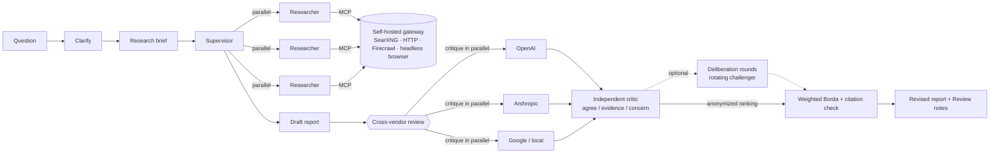

# Crossvet

[](https://github.com/j-zulick/crossvet/actions/workflows/ci.yml) [](LICENSE) [](.python-version)

**Deep research whose reports are checked by models from several AI vendors before you see them.**

Crossvet extends LangChain's [Open Deep Research](https://github.com/langchain-ai/open_deep_research) (MIT). A single model writing a research report will state unsupported claims with confidence. Crossvet adds a **cross-vendor review** stage: after the draft report is written,

1. reviewers from different vendors (e.g. OpenAI, Anthropic, Google, or a self-hosted model) critique it **independently and in parallel**, as typed objects;
2. the critiques are **anonymized and shuffled**, and every reviewer ranks them — combined with a **confidence-weighted Borda count**;
3. a **deterministic citation check** flags any URL the report cites that never appeared in the research notes;
4. an **independent critic** (always a different model from the finding's author) checks every reviewer finding against the research notes: *agree*, *disagree with evidence* (an exact quote, verified in code before it can overrule anything), or *disagree concern*. Contradicted findings are dropped; unresolved ones go to a **Disputed** section for a human;
5. optionally, reviewers **deliberate** for up to three rounds (`REVIEW_DELIBERATION_ROUNDS`): a rotating challenger contests findings and the author holds, revises or withdraws them. A change of position counts only with a passage from the research notes, verified in code; changes without one are ignored and flagged as possible sycophancy. Challengers label every finding AGREE, DISAGREE or BUILD_ON, and code stops deliberation early on consensus or a stable disagreement, with a guard against agreement the notes don't back (see [Early stopping](#early-stopping-in-deliberation)). Optionally, a **blind first pass** has every reviewer outline the answer from the notes before reading the draft, and grounded points the draft omits become feedback (see [Blind first pass](#blind-first-pass));
6. the report is revised with the top-ranked feedback and ends with **Review notes**: per-model scores, the peer-voted best critique, dissent, critic outcome, flagged citations, and any reviewer that failed.

**See it on a real run:** [docs/examples/jwst-mirror.md](docs/examples/jwst-mirror.md): an OpenAI + Claude panel scored the first draft 4/10; the revised report and its Review notes are reproduced unedited.




## Design principles

Each design choice addresses a documented failure mode of using LLMs to judge LLM output. The papers explain *why* each choice was made; they are not claims that Crossvet reproduces their results.

| Principle | How Crossvet implements it | Evidence |
|---|---|---|
| Reviewers from different vendors | `REVIEW_MODELS` spans vendors; the setup checker warns on a single-vendor panel | Diversity from different models was critical to multi-model consensus gains [1] |
| Confidence-weighted voting | Ballots carry confidence; critiques are ranked with a confidence-weighted Borda count | Confidence-weighted voting across diverse models [1] |
| Anonymize and shuffle before ranking | Critiques become `C1…Cn` in random order before any model ranks them | LLM judges show position and self-enhancement bias [2]; LLMs recognize and favor their own generations [3] |
| Reviser outside the panel | `REVIEW_REVISER_MODEL`, with a warning when it shares a vendor with a reviewer | Self-preference [3]; twelve documented LLM-as-judge biases [4] |
| Hold positions without new evidence | Reviewer and vote prompts reward evidence over confident or agreeable wording | Models trained on human feedback show sycophancy [5] |
| Deterministic citation check | URLs cited in the report are matched against what research actually read | Even strong models often lack complete citation support [6] |
| Evidence-grounded critic | Each finding goes to a critic from a different model than its author; a disagreement counts only with a quote that is verified, in code, to appear in the research notes; unresolved findings go to a *Disputed* section | Structured disagreement between reviewers, with explicit guards against capitulation [7] |
| Position changes need evidence | In deliberation rounds a reviewer may revise or withdraw a finding only with a passage from the notes, verified in code; other changes are ignored and flagged | Models shift answers to agree with a user or a confident challenger [5]; guards against capitulation in reviewer debate [7] |
| Outline before reading the draft | With the blind pass, reviewers list the points a correct answer needs, each with a passage from the notes, before they see the draft; code adds grounded points the draft omits to the feedback | LLM judges anchor on what they are shown, including position and order [2] |
| Stop debating when it stops helping | Code ends deliberation on consensus or a stable disagreement; endorsements that cite nothing in the notes buy one more round instead of ending it | An adaptive break of debate was needed for multi-agent debate to perform well [8]; agreement is not evidence [5] |

[1] Chen, Saha & Bansal, *ReConcile: Round-Table Conference Improves Reasoning via Consensus among Diverse LLMs*, ACL 2024. https://aclanthology.org/2024.acl-long.381/
[2] Zheng et al., *Judging LLM-as-a-Judge with MT-Bench and Chatbot Arena*, NeurIPS 2023 (Datasets & Benchmarks). https://arxiv.org/abs/2306.05685
[3] Panickssery, Bowman & Feng, *LLM Evaluators Recognize and Favor Their Own Generations*, NeurIPS 2024. https://arxiv.org/abs/2404.13076
[4] Ye et al., *Justice or Prejudice? Quantifying Biases in LLM-as-a-Judge*, ICLR 2025. https://arxiv.org/abs/2410.02736
[5] Sharma et al., *Towards Understanding Sycophancy in Language Models*, ICLR 2024. https://arxiv.org/abs/2310.13548
[6] Gao, Yen, Yu & Chen, *Enabling Large Language Models to Generate Text with Citations*, EMNLP 2023. https://arxiv.org/abs/2305.14627
[7] Qiu & Gill, *Adversarial Review: Structured Disagreement for Grounded Agentic Code Review*, ICML 2026 DL4C Workshop. https://arxiv.org/abs/2608.18167
[8] Liang et al., *Encouraging Divergent Thinking in Large Language Models through Multi-Agent Debate*, EMNLP 2024. https://aclanthology.org/2024.emnlp-main.992/

## Early stopping in deliberation

Deliberation costs two model calls per critique per round. Since v1.1 code, not a model, decides after each round whether another round is worth paying for:

| Stop reason | When |
|---|---|
| `consensus` | No finding moved this round and the challengers endorsed at least `REVIEW_CONSENSUS_THRESHOLD` of the findings (default 1.0, unanimous) |
| `stable` | Findings are still contested, but nothing moved for two rounds in a row |
| `no_findings` | Nothing is left to review |
| `max_rounds` | The cap (`REVIEW_DELIBERATION_ROUNDS`, at most 3) was reached |

Every challenger labels each finding **AGREE**, **DISAGREE** or **BUILD_ON** by its anonymous id. DISAGREE goes to the author as a challenge. BUILD_ON adds to the finding only when its quote is found in the notes. **False-consensus guard:** if fewer than `REVIEW_CONSENSUS_MIN_GROUNDED_SHARE` (default 0.5) of the endorsements cite a passage that is in the notes, or the challengers said nothing, one more round runs with the next challenger before deliberation may stop. So with early stopping on, a silent challenger costs one extra round, where v1.0 stopped at once.

The Review notes say why deliberation stopped and how many rounds it saved; the run export, `crossvet-compare` (`rounds_saved`, `mean_agreement_rate`, `deliberation_calls`) and Langfuse (scores `rounds_saved`, `agreement_rate`, `deliberation_calls` and a categorical `stop_reason`) record the same. `crossvet-setup --compare-plan` writes a `deliberation-3-fixed` vs `deliberation-3-early-stop` pair so you can measure the saving on your own questions. `REVIEW_DELIBERATION_EARLY_STOP=false` restores the v1.0 rule.

## Blind first pass

A draft anchors whoever reads it: reviewers check what it says and tend to miss what it leaves out. With `REVIEW_BLIND_PASS_ENABLED=true`, each reviewer first answers from the research notes alone, without seeing the draft: up to `REVIEW_BLIND_MAX_POINTS` (6) points, each with the passage that supports it, in one short call (`REVIEW_BLIND_MAX_TOKENS`, 1500). Then code:

1. drops points whose passage is not verbatim in the notes;
2. marks a point **covered** when the draft has the passage's numbers and most of its distinctive words;
3. adds every grounded, uncovered point to that reviewer's critique as an omission (deduplicated across reviewers), so it reaches the vote and the reviser.

Each reviewer also sees its own outline when it critiques the draft. The Review notes report points, coverage, omissions and dropped points; the export keeps every outline; `crossvet-compare` and Langfuse record `blind_omissions`, and the compare plan adds a `blind-pass` setup to compare with `review`. Coverage is a word-overlap heuristic: a paraphrase with different wording can be counted as an omission, which the reviser then sees as feedback rather than as a fact.

## Grounded search on self-hosted infrastructure

Research can run on a search stack I operate instead of a paid search API (`SEARCH_API=gateway`). The agent talks to a **research gateway over MCP** (Streamable HTTP, bearer token):

- **Discovery** — SearXNG metasearch across several engines, with merged ranks and the engine recorded for every result, plus a private crawl index.
- **Layered reading** — plain HTTP first, then Firecrawl for JavaScript-heavy pages, then a headless browser. Every source reports which reader handled it and an honest status (`ok`, `partial`, `blocked`, `failed`); nothing is silently dropped.
- **Saved evidence** — pages are stored with final URL, fetch time and content hash, so claims can be traced back to exact passages.
- **Safety** — private and cloud-metadata addresses are refused before any fetch (SSRF protection); every call is authenticated.
- **Checked twice** — the cross-vendor review flags unsupported claims, and the deterministic citation check flags any URL the research never read.

| | Self-hosted gateway | Hosted search API | Model-native web search |
|---|---|---|---|
| Per-query cost | infrastructure only | per call | bundled in model tokens |
| Data leaves your infrastructure | no | yes | yes |
| Per-source provenance and read status | yes | partial | limited |
| Control over engines and readers | full | none | none |

The adapter (`src/open_deep_research/gateway_search.py`) tolerates schema differences between gateway releases and isolates per-query failures.

## Documentation
[Architecture](docs/ARCHITECTURE.md) · [Design decisions](docs/DESIGN-DECISIONS.md) · [Evaluations](docs/EVALS.md) · [Changelog](CHANGELOG.md) · [Security](SECURITY.md)

## Stack
Python 3.13 · uv · **LangGraph 1.2** (interrupts, SQLite / Postgres checkpointers) · LangChain 1.x (`init_chat_model`, any provider) · **Pydantic v2** typed outputs · **self-hosted models** via Ollama or any OpenAI-compatible server · **Deep Agents** (`deepagents`) edition · **Langfuse** tracing · **MCP** server · pytest · ruff · GitHub Actions (CodeQL, gitleaks, SBOM) · Docker Compose · **Agent Chat UI** (Next.js 16, React 19, Tailwind 4) in `web/`.

## Quickstart
Requires Python 3.11–3.13 (the repo pins 3.13 in `.python-version`; `uv` downloads it if needed). Newer Python versions may lack prebuilt packages for some dependencies.

```bash
scripts/quickstart.sh     # checks tools, installs, asks for keys (hidden), picks models your keys can use,
                          # tests each model with one tiny request, runs the setup check and a first research run
```
Or step by step:
```bash
uv sync
uv run crossvet-setup --check                        # writes .env: cross-vendor panel + independent reviser from available models
uv run python -m open_deep_research.doctor           # checks keys, reviewers, search; never prints key values
uv run crossvet-try                                  # one run; saves report, review and a key-free share.md
uv run langgraph dev --config langgraph.local.json   # API on :2024, opens LangGraph Studio

# optional web UI
cd web && cp .env.example .env && pnpm install && pnpm dev   # http://localhost:3000
```

**Or with Docker** — one command for the API (both editions) and the web UI, bound to localhost:
```bash
cp .env.example .env            # add your keys
docker compose up --build       # API http://localhost:2024 · web UI http://localhost:3000
```

**Search:** `SEARCH_API=gateway` (with `RESEARCH_GATEWAY_URL` and `RESEARCH_GATEWAY_TOKEN`), `tavily` (with `TAVILY_API_KEY`), or `openai` / `anthropic` to use the model's built-in web search with no extra key (`crossvet-setup` picks this when no Tavily key is set). With built-in search, every source the search consulted is added to the research notes, so the citation check still works; the gateway and Tavily also capture each page's text for the critic to quote. **Combined search:** add `SEARCH_ALSO=openai` (or `anthropic`) to give researchers the model's built-in search next to the gateway or Tavily, so research continues if one source returns nothing; the researcher model must be from that vendor.

**Models:** every stage is configurable (`RESEARCH_MODEL`, `SUMMARIZATION_MODEL`, `COMPRESSION_MODEL`, `FINAL_REPORT_MODEL`). Reviewers are set with `REVIEW_MODELS` as `provider:model` strings — `openai:…`, `anthropic:…`, `google_genai:…`, `openrouter:<model>` (with `OPENROUTER_API_KEY`), `ollama:<model>`, or `local:<model>` for any OpenAI-compatible server (llama.cpp, LM Studio, MLX, vLLM) at `LOCAL_LLM_BASE_URL`. At least two reviewers must respond (quorum); failures are reported, not fatal. Set `REVIEW_REVISER_MODEL` to a model from a vendor that is *not* on the panel, so no lab grades and then rewrites its own work; Crossvet adds a warning to the Review notes when the reviser shares a vendor with a reviewer. Turn the stage off with `CROSS_VENDOR_REVIEW_ENABLED=false`.

## Durable runs from the command line
```bash
uv run crossvet run "How are EU AI Act obligations phased in for general-purpose models?" --out report.md
uv run crossvet status --thread <id>      # where did it stop?
uv run crossvet resume --thread <id>      # continue after a crash or Ctrl-C
```
Every step is checkpointed (SQLite by default, Postgres with `DATABASE_URL=postgresql://...` and `uv sync --extra postgres`). A run that crashes mid-way resumes from its last checkpoint without repeating completed — already paid-for — model calls.

**Human approval:** with `REQUIRE_APPROVAL=true` the run pauses after research. Approve, type instructions to steer the report, or reject before any report tokens are spent — at the terminal, or with approve / edit / reject buttons in the web UI. `--auto-approve` skips the prompt.

**Tracing and cost:** set `LANGFUSE_PUBLIC_KEY`, `LANGFUSE_SECRET_KEY` (and `LANGFUSE_BASE_URL` for a self-hosted Langfuse) and every model call in a CLI run is traced with tokens and cost per model. The LangGraph server also supports LangSmith tracing natively.

## Two editions
- **LangGraph edition** (`deep_researcher`, default): an explicit research graph — brief, supervisor, parallel researchers, compression, report.
- **Deep Agents edition** (`deep_agent`): research and drafting by a LangChain [Deep Agent](https://github.com/langchain-ai/deepagents) that plans with a to-do list, delegates sub-questions to researcher sub-agents and keeps notes in a virtual filesystem.

Both end in the same cross-vendor review. In the Deep Agents edition every search result returned to the agent or a sub-agent is captured by a callback and becomes the research notes, so the citation check, critic and deliberation verify against what was actually retrieved, not against the agent's own summary. With a model's built-in search (`SEARCH_API=openai` or `anthropic`) the sources are read from each model reply instead, including the sub-agents'. Pick the edition in LangGraph Studio or the web UI (`NEXT_PUBLIC_ASSISTANT_ID=deep_agent`), and compare the two with `crossvet-compare --setups examples/compare/editions.toml`.

## Compare models
Run the same questions through different model setups — hosted, OpenRouter, Ollama or a local server, in any role — and compare what each produced:
```bash
uv run crossvet-compare --setups examples/compare/setups.toml --questions examples/compare/questions.txt --repeats 2
```
To compare the models you actually have, let setup write the plan: `uv run crossvet-setup --compare-plan my-setups.toml` creates setups for review vs no review and for each Ollama or local model as report writer and as reviewer (plus deliberation and the Deep Agents edition when available). `examples/compare/questions-15.txt` has 15 questions with checkable answers.

With `LANGFUSE_PUBLIC_KEY` and `LANGFUSE_SECRET_KEY` set, every comparison run is also a Langfuse trace: one session per comparison, tagged `setup:<name>`, with scores attached (finished, cited and flagged URLs, flagged-URL rate, reviewer score, critic drops and disputes, seconds) and token cost per model. `results.jsonl` records each run's trace id.
Each setup is a named set of configuration overrides. Results go to `compare-results/`: one JSON line per run, a per-setup `summary.md` / `summary.csv` (finished runs, latency, input and output tokens, share of cited URLs the research never read, reviewer scores, critic drops and disputes, failed reviewers) and every report for side-by-side reading. A failed run is recorded and the comparison continues.

## Use it from Claude Code, Codex or Cursor (MCP)
`crossvet-mcp` is an MCP server (stdio) with two tools:
- `ask_model(model, prompt)` — ask any configured model, cloud or local;
- `compare_models(prompt, models?)` — ask several models in parallel; per-model failures are reported, never hidden.

```bash
claude mcp add crossvet -- uv --directory /path/to/crossvet run crossvet-mcp
```

## Run export and fine-tuning data
Set `RUN_EXPORT_PATH=runs/review.jsonl` to append every reviewed run (research notes, draft, critiques, critic verdicts, deliberation, ballots, feedback, revision) as one JSON line.

`crossvet-dataset` turns those runs into chat-format datasets that `mlx_lm.lora` reads directly, so a model on your own Mac can learn from the hosted panel:
```bash
uv run crossvet-dataset --runs runs/review.jsonl --task critique --out data/critique   # notes + draft -> peer-voted, evidence-checked critique
uv run crossvet-dataset --runs runs/review.jsonl --task revise --out data/revise       # notes + draft + feedback -> citation-clean revision
mlx_lm.lora --model <model> --train --data data/critique --iters 600 --mask-prompt
mlx_lm.lora --model <model> --adapter-path adapters --data data/critique --test
mlx_lm.fuse --model <model> && mlx_lm.server --model fused_model                      # OpenAI-style API on localhost:8080
```
Splits are by research brief, so a question never appears in both training and test data. Only top-voted critiques that survived the critic, and only revisions that cite nothing the research did not read, become training targets. Then compare the base and fine-tuned model as a `local:` reviewer with `crossvet-compare`. Exports contain web content: check your sources' terms and keep datasets private.

## Tests
```bash
uv run pytest tests/unit -q     # offline: no API keys, no network
```
Covers the blind pass (grounding, coverage, omissions, prompts that never include the draft), early stopping (consensus, stable disagreement, the false-consensus guard and build-on grounding), anonymization (no vendor leaks into labels), Borda tallying, citation flagging, the critic protocol (fabricated evidence quotes are never trusted), quorum and failure handling, run export, the MCP tools, gateway parsing, self-hosted model wiring, the approval step with real LangGraph interrupts, the comparison harness, deliberation and the sycophancy guard, the Deep Agents edition (search capture and report file), fine-tuning dataset building, and crash-and-resume across two processes (a completed step is never re-run).

## Roadmap
- [x] **v0.1** — cross-vendor review, LangGraph 1.2 / LangChain 1.x upgrade, self-hosted model support, web UI, CI
- [x] **v0.2** — evidence-grounded critic and *Disputed* section, JSONL run export, MCP server (`ask_model`, `compare_models`)
- [x] **v0.3** — durable CLI runs (SQLite / Postgres checkpoints, resume), human approval before the final report, Langfuse tracing
- [x] **v0.4** — model comparison harness: any cloud or local model in any role, compared on citation support, critic outcomes, failures, latency and tokens
- [x] **v0.5** — deeper deliberation: rotating challenger, capped rebuttal rounds, position-change tracking with sycophancy flags
- [x] **v0.6** — Deep Agents edition (planning, sub-agents, virtual filesystem), compared against the LangGraph edition
- [x] **v0.7** — fine-tuning data path: run exports to MLX LoRA datasets for a self-hosted model, measured before/after
- [x] **v0.8** — grounded search on self-hosted infrastructure (metasearch, layered page reading, saved evidence, SSRF protection) via MCP
- [x] **v1.0** — one-command Docker Compose, security scanning in CI, architecture and evaluation docs
- [x] **v1.2** — blind first pass: reviewers outline the answer from the notes before reading the draft; grounded omissions become feedback
- [x] **v1.1** — deliberation that stops when it stops helping: AGREE / DISAGREE / BUILD_ON labels, code-decided consensus and stable-disagreement stops, false-consensus guard, rounds saved in notes, compare and Langfuse

## Credits
Built on [Open Deep Research](https://github.com/langchain-ai/open_deep_research) and [Agent Chat UI](https://github.com/langchain-ai/agent-chat-ui) (both MIT). Anonymized model peer review is inspired by Andrej Karpathy's *llm-council*; explicit agree / disagree / build-on engagement, a blind first pass and stopping on consensus also appear in Terry Li's MIT-licensed *consilium* (Crossvet's versions are reimplemented and verified against the research notes in code; see [design decision 12](docs/DESIGN-DECISIONS.md#12-stop-deliberation-in-code-not-by-a-models-say-so)); the critic's agree / disagree-with-evidence / disagree-concern protocol is adapted from the MIT-licensed *review-council* skill and the research it cites. Details in [NOTICES.md](NOTICES.md); the original upstream README is in [docs/UPSTREAM-README.md](docs/UPSTREAM-README.md).

## License
MIT — see [LICENSE](LICENSE) (upstream) and [NOTICES.md](NOTICES.md).
