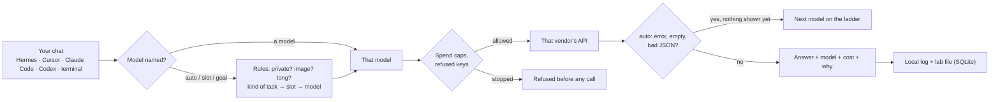

# Crossvet

**One chat, any model.** Use Claude, ChatGPT, Gemini, Grok or a model on your own machine from the chat you already use (Hermes, Cursor, Claude Code, Codex or a terminal). Name the model yourself, or name `auto` and Crossvet chooses one, says why, and tries the next model when an answer fails a check. Have a model from another vendor review your code change, and see only the findings that match the diff. Turn on a judge to score a sample of your real answers, see which model is good enough for each kind of task, and let `auto` route to the cheapest one that is. Every answer shows which model gave it and what it cost, and spend caps stop a call before it is made.

[](https://github.com/j-zulick/crossvet/actions/workflows/ci.yml)
[](https://github.com/j-zulick/crossvet/actions/workflows/codeql.yml)
[](https://github.com/j-zulick/crossvet/releases/latest)
[](pyproject.toml)
[](LICENSE)

```
$ crossvet route "Write a Python function parse_listing(s) that turns '2021 Toyota Tacoma SR5 - 34,210 mi - $31,995' into a dict"
anthropic:claude-opus-5-5 answers. Kind of task: code (difficulty 2): it is about code ("Python"). Slot: strong;
goal: auto. If it fails, Crossvet tries openai:gpt-6.1-sol.

$ crossvet ask -m auto "Sarasota Ford is at 707 S Washington Blvd., Sarasota, FL 34236. What is its ZIP code? Number only."
34236
[anthropic:claude-haiku-5-5 · 55 in / 106 out · $0.0001 · 1.0 s · auto: quick slot, /why explains]

$ crossvet review --author sol --reviewer sonnet --task "Accept the bearer token from the Authorization header." < token-check.diff
anthropic:claude-sonnet-5-5 reviewed the change by openai:gpt-6.1-sol: 1 finding(s) kept ($0.0044).
  src/crossvet/server.py:144 [blocker] The `or bool(sent)` short-circuit authorizes any request that sends a non-empty
  Authorization value, whatever the token, so authentication is bypassed.
  decision record: .crossvet/reviews/…-review.md

$ crossvet route "[private] Draft the deposit receipt for card 4111 1111 1111 1111"
crossvet: this request looks private ([private]), and no private model is set, so it was not sent anywhere. Add
[slots] private = ["ollama:..."] (a model on this computer), remove the private details, or name a model yourself.
```

From the released build: the `route` lines are its output (it calls no model); the answer and the review (the `token-check` case of the review benchmark) are from the live runs of 2026-11-26 ([3.0.0](docs/live-runs/2026-11-26-v3.0.0.md), [3.1.0](docs/live-runs/2026-11-26-v3.1.0.md)); the tasks come from used-car dealer work in Sarasota, Florida, and from Crossvet's own code.

In a chat, switch models without losing the conversation (`crossvet chat`, 2026-11-26, [full run](docs/live-runs/2026-11-26-v3.5.0.md)):

```
you> Write a one-line online listing title for a 2021 Toyota Tacoma SR5, 34,210 miles, $31,995, at Sarasota Ford. Title only.
anthropic:claude-haiku-5-5> 2021 Toyota Tacoma SR5 | 34,210 Miles | $31,995 | Sarasota Ford
you> /model sol
you> Now cut that title to 60 characters or fewer for a text message. Title only.
openai:gpt-6.1-sol> 2021 Toyota Tacoma SR5 | 34,210 mi | $31,995 | Sarasota Ford
you> /model auto
you> How many characters is your last title? Number only.
auto> 60
[anthropic:claude-opus-5-5 · 189 in / 195 out · $0.0047 · 1.9 s · auto: strong slot, /why explains]
you> /cost
  total $0.0063 (Opus $0.0047, Sol $0.0016, Haiku under $0.0001)
```

Shortened: the typed lines sit next to the answers and the `/cost` table is summed up in one line; the [run](docs/live-runs/2026-11-26-v3.5.0.md) has the output exactly as printed.

## Quick start

```bash
uv tool install "git+https://github.com/j-zulick/crossvet@v3.6.1"
mkdir -p ~/.config/crossvet && cp .env.example ~/.config/crossvet/.env   # then fill in the keys you have
crossvet start
```

`crossvet start` checks your keys without calling a model, prints the settings for each app below, and starts the server. To keep it running, `crossvet service install` starts it at login (launchd on macOS, systemd on Linux); on a server, use the `Dockerfile` and `compose.yaml` ([docs/DEPLOY.md](docs/DEPLOY.md)). Three dependencies (httpx, the MCP Python SDK, python-dotenv); Python 3.11 to 3.13. More: [docs/SETUP.md](docs/SETUP.md).

## Use it from the chat you already have

| Your chat | Connect once | Pick the model |
|---|---|---|
| **Hermes**, or any app that takes an OpenAI-style URL | Custom provider at `http://127.0.0.1:8787/v1` (keep `crossvet start` running) | The app's model menu (Crossvet lists your models and `auto` at `/v1/models`), or type `/model NAME` |
| **Claude Code** | `claude mcp add --scope user crossvet -- crossvet mcp` | Ask it to use `ask_model` with the model you want, or `ask` to let Crossvet choose |
| **Codex** | `codex mcp add crossvet -- crossvet mcp` | The same |
| **Cursor** | `crossvet start --no-serve` prints the `~/.cursor/mcp.json` entry | The same |
| **Claude Code plugin** | `/plugin marketplace add j-zulick/crossvet`, then `/plugin install crossvet@crossvet` | `/crossvet-review` reviews your change with another vendor |
| A terminal | `crossvet chat --model opus`, `crossvet chat --model auto` or `crossvet ask -m sol "..."` | `/model NAME` |

A model is named `provider:model` (`anthropic:claude-opus-5-5`, `openai:gpt-6.1-sol`, `google:...`, `xai:...`, `openrouter:vendor/model`, `ollama:...`) or by a short name you set (`opus`, `sonnet`, `sol`, `luna`). A request that names no model goes to your `default_model`. `auto`, `crossvet/<slot>` (`crossvet/strong`) and `crossvet/<goal>` (`crossvet/cheapest`) let Crossvet choose.

In any of them, typed as a whole message: `/model NAME`, `/models`, `/cost`, `/why` (why auto chose), `/good` and `/bad` (rate the last answer), `/retry stronger` (ask again one slot up).

## How it works



- **A named model is never switched.** No routing, no fallback, no silent retries for it. If a call fails, the error names the model and you pick another.
- **`auto` explains itself.** The choice is made in code from the request alone: private-looking text stays on your machine or is refused; images go to a vision model; otherwise the kind of task (code, review, writing, summarize, extract, translate, reasoning, quick, general) picks a slot. `/why` shows the reason and every attempt. Escalation happens only after an error, an empty answer or invalid JSON, and only before anything is shown.
- **It learns only when you say so.** `/good` and `/bad` record ratings. `crossvet tune` proposes a better model for a kind of task from them, and nothing changes until you accept; every change rolls back.
- **Scores from your own use, opt-in.** With `[score] enabled`, a judge from another vendor scores a sample of your answers 1 to 5 against a rubric for the kind of task, under its own daily cap; a cheaper model can answer some of the same questions in the background. `crossvet score calibrate` checks the judge against your ratings, and `crossvet leaderboard` shows score and cost per model for each kind of task. Private-looking requests are never judged.
- **Routing from scores, cautiously.** With `[router] use = "scores"`, `auto` sends each kind of task to the cheapest model whose cautious judged score is within a margin of the best, once each has enough judged answers; 5% of requests explore the second choice. `crossvet tune auto` (opt-in) changes routes at most once a week per kind and rolls back a change that scores worse. `crossvet report --week` shows the saving against always using the strongest model.
- **Code review by another vendor, checked in code.** `crossvet review --staged` (or `review_diff` from any agent) sends your change to a reviewer from a different vendor than the author model. A finding is shown only if its file, line, quote and severity match the diff; `--fix --apply` writes a patch that `git apply --check` must accept and reviews again, and every review leaves a decision record.
- **Several vendors when you want them.** `compare` asks several models at once; `challenge` has another vendor check an answer, with its verdict read in code; `replay` runs your past questions on another model and a blind judge picks the better answer.
- **Agents keep their tools.** Hermes and other agents send tools and tool results, and Crossvet passes them to the model, streamed when the app streams. OpenAI models get them through the Responses API (their current models refuse tools on chat completions), with their encrypted reasoning kept and sent back across tool steps; Anthropic models through Anthropic's OpenAI-compatible endpoint. A request field a vendor has no place for is reported, never dropped silently.
- **Costs are visible and capped.** Each answer is priced from the vendor's list price (or OpenRouter's reported cost). A daily cap and a per-call worst-case cap stop a call before it is made. A provider that rejects your key or reports a billing problem is not called again until restart.
- **Two local files.** Every question and answer goes to one append-only SQLite log shared by every app; decisions, ratings, notes and accepted routes go to a second file next to it. `report`, `dashboard`, `export`, `sync` (Langfuse), `backup` and `restore` work on both.

## Tested with real API calls

`tests/live/` calls the real APIs (`CROSSVET_LIVE=1 uv run pytest tests/live`). The [run of 2026-11-27](docs/live-runs/2026-11-27-v3.6.1.md) passed all 26 checks with OpenAI, Anthropic and Langfuse keys, for **$0.088**:

- each of six models answered when named; through the server, `/model` switched vendors mid-conversation, the answer streamed, and `/cost` showed both;
- agents' tool calls round-tripped (call `lookup_vin`, send the result, get the price) with Claude Sonnet, GPT-6.1 Sol and GPT-6 Luna, including streamed loops with two tool calls at once and OpenAI reasoning kept across tool steps;
- `auto` sent the ZIP-code question to the quick slot (Claude Haiku, right answer) and the parsing function to the strong slot (Claude Opus);
- a model that doesn't exist failed with HTTP 404 and `auto` moved to the next model on the ladder, recording both attempts;
- `compare` got answers from both vendors; `challenge` had Claude Sonnet check a wrong answer from the other vendor and return `wrong` with the reasons;
- a planted auth bypass, said to be written by GPT-6.1 Sol, was reviewed by Claude Sonnet, which flagged the exact line as a blocker;
- the judge (GPT-6.1 Sol, since the answer came from Anthropic) scored Claude Haiku's mileage answer 3 of 5; a shadow answer from GPT-6 Luna, judged by Claude Sonnet, scored 5;
- with routing from scores, four real judged answers (Luna and Haiku tied at 5.0) were enough for `auto` to pick from scores and explain the choice (a test setting of 2 judged answers per model; the default is 20);
- `crossvet serve`, started as its own process, answered `/health` and an HTTP request with `"model": "auto"` (Claude Haiku, `34236`, with the decision in the response);
- on four benchmark cases, Claude Haiku scored 1.0 on all four and GPT-6 Luna on three (0.5 on a 40-word summary); a per-call cap and a rejected key stopped calls before they were made; the MCP server listed its 16 tools, answered, and explained a route;
- `crossvet sync` sent a Claude Haiku answer and its rating to Langfuse Cloud (v4), where it showed as a generation with the model, tokens, cost and the `user_rating` score within 10 seconds.

The live runs found five problems before release, all fixed and covered by tests ([3.0.0](docs/live-runs/2026-11-26-v3.0.0.md), [3.2.0](docs/live-runs/2026-11-26-v3.2.0.md)): "ZIP code" counted as program code; a short fact plus a question was not counted as quick; "answer in one sentence" made a question count as a summary; parallel calls could collide on the log's one SQLite connection; and a lab file could end up next to the wrong log. The full chat benchmark (28 cases, six models, $0.48) is in [docs/benchmarks/2026-11-25](docs/benchmarks/2026-11-25/README.md). In the [review benchmark](docs/benchmarks/2026-11-26-review/README.md) (twelve planted bugs in Crossvet's own code), five of six reviewers caught all twelve, GPT-6 Luna for $0.002; Claude Opus described the other two without the required severity, so the checks dropped them ($0.16 in all). In the [hard set](docs/benchmarks/2026-11-27-review-hard-repeat/README.md) (twelve subtler bugs and six clean changes, three runs each, $0.64), no reviewer raised a false alarm on a clean change; Claude Haiku and GPT-6.1 Terra caught all twelve bugs in every run, Claude Opus only four, and 15 of the 20 misses were findings the checks dropped (mostly a missing severity) rather than bugs left unseen. Not tested live yet: the Hermes, Cursor, Claude Code and Codex apps themselves (and the plugin and skills inside them), scoring over weeks of real traffic, a launchd agent loaded on macOS, the container image, handoffs, Google, xAI, OpenRouter and local models.

## Project layout

About 6,000 lines of Python in 22 modules, with 224 offline tests (some built from replies recorded from the real APIs) and 26 live ones.

| File | What it does |
|---|---|
| `src/crossvet/core.py` | The one path every request takes: resolve or choose, check the caps, call, escalate (auto only), log |
| `src/crossvet/routing.py`, `classify.py` | `auto`: private requests, inputs, the kind of task, slots, goals, the ladder, and the explanation |
| `src/crossvet/providers.py` | OpenAI, Anthropic, Google, xAI, OpenRouter, Ollama and any OpenAI-compatible server through one function |
| `src/crossvet/relay.py` | Agents' requests with tools: streamed, translated for OpenAI's Responses API, reasoning kept across tool steps |
| `src/crossvet/server.py` | The OpenAI-compatible server for Hermes and other chat apps |
| `src/crossvet/mcp_server.py` | 16 MCP tools: `list_models`, `ask_model`, `recent_turns`, `ask`, `explain_route`, `compare_models`, `challenge`, `review_diff`, `leaderboard`, `rate_answer`, notes and handoffs |
| `src/crossvet/score.py` | The opt-in judge, shadow answers, calibration against your ratings, the leaderboard |
| `integrations/n8n/`, `integrations/windmill/` | The weekly job: score, tune, report |
| `src/crossvet/review.py`, `review_bench.py` | Second-vendor review with findings checked against the diff, fix rounds, decision records; the review benchmarks (planted bugs, and a hard set with clean changes) |
| `integrations/` | The Claude Code plugin, and skills for Codex and Hermes |
| `src/crossvet/multi.py`, `bench.py`, `tuning.py` | Compare, challenge, blind replay; the Sarasota benchmark; route proposals from ratings |
| `src/crossvet/lab.py`, `store.py`, `care.py`, `langfuse.py`, `handoff.py` | The lab file and the log; report, dashboard, export, backup; Langfuse sync; Claude Code and Codex handoffs |
| `src/crossvet/service.py`, `Dockerfile`, `compose.yaml` | The server at login (launchd, systemd) with an optional weekly job; a container for a server or Komodo |
| `src/crossvet/config.py`, `cli.py` | Settings (names, slots, routes, prices, limits); the `crossvet` command |

## Documentation

[Using Crossvet](docs/CHAT.md) · [Setup](docs/SETUP.md) · [Architecture](docs/ARCHITECTURE.md) · [Design decisions](docs/DESIGN-DECISIONS.md) · [Security model](docs/SECURITY-MODEL.md) · [What stays stable](docs/STABILITY.md) · [Running it every day](docs/DEPLOY.md) · [Moving to 3.x](docs/MIGRATING.md) · [Changelog](CHANGELOG.md)

## License

MIT. See [LICENSE](LICENSE) and [NOTICES.md](NOTICES.md).
