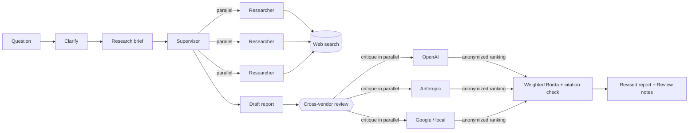

# Crossvet

**Deep research whose reports are checked by models from several AI vendors before you see them.**

Crossvet extends LangChain's [Open Deep Research](https://github.com/langchain-ai/open_deep_research) (MIT). A single model writing a research report will state unsupported claims with confidence. Crossvet adds a **cross-vendor review** stage: after the draft report is written,

1. reviewers from different vendors (e.g. OpenAI, Anthropic, Google, or a self-hosted model) critique it **independently and in parallel**, as typed objects;
2. the critiques are **anonymized and shuffled**, and every reviewer ranks them — combined with a **confidence-weighted Borda count**;
3. a **deterministic citation check** flags any URL the report cites that never appeared in the research notes;
4. the report is revised with the top-ranked feedback and ends with **Review notes**: per-model scores, the peer-voted best critique, dissent, flagged citations, and any reviewer that failed.



## Design principles

Each design choice addresses a documented failure mode of using LLMs to judge LLM output. The papers explain *why* each choice was made; they are not claims that Crossvet reproduces their results.

| Principle | How Crossvet implements it | Evidence |
|---|---|---|
| Reviewers from different vendors | `REVIEW_MODELS` spans vendors; the setup checker warns on a single-vendor panel | Diversity from different models was critical to multi-model consensus gains [1] |
| Confidence-weighted voting | Ballots carry confidence; critiques are ranked with a confidence-weighted Borda count | Confidence-weighted voting across diverse models [1] |
| Anonymize and shuffle before ranking | Critiques become `C1…Cn` in random order before any model ranks them | LLM judges show position and self-enhancement bias [2]; LLMs recognize and favor their own generations [3] |
| Reviser outside the panel | `REVIEW_REVISER_MODEL`, with a warning when it shares a vendor with a reviewer | Self-preference [3]; twelve documented LLM-as-judge biases [4] |
| Hold positions without new evidence | Reviewer and vote prompts reward evidence over confident or agreeable wording | Models trained on human feedback show sycophancy [5] |
| Deterministic citation check | URLs cited in the report are matched against what research actually read | Even strong models often lack complete citation support [6] |

[1] Chen, Saha & Bansal, *ReConcile: Round-Table Conference Improves Reasoning via Consensus among Diverse LLMs*, ACL 2024. https://aclanthology.org/2024.acl-long.381/
[2] Zheng et al., *Judging LLM-as-a-Judge with MT-Bench and Chatbot Arena*, NeurIPS 2023 (Datasets & Benchmarks). https://arxiv.org/abs/2306.05685
[3] Panickssery, Bowman & Feng, *LLM Evaluators Recognize and Favor Their Own Generations*, NeurIPS 2024. https://arxiv.org/abs/2404.13076
[4] Ye et al., *Justice or Prejudice? Quantifying Biases in LLM-as-a-Judge*, ICLR 2025. https://arxiv.org/abs/2410.02736
[5] Sharma et al., *Towards Understanding Sycophancy in Language Models*, ICLR 2024. https://arxiv.org/abs/2310.13548
[6] Gao, Yen, Yu & Chen, *Enabling Large Language Models to Generate Text with Citations*, EMNLP 2023. https://arxiv.org/abs/2305.14627

## Stack
Python 3.13 · uv · **LangGraph 1.2** · LangChain 1.x (`init_chat_model`, any provider) · **Pydantic v2** typed outputs · **self-hosted models** via Ollama or any OpenAI-compatible server · pytest · ruff · GitHub Actions · **Agent Chat UI** (Next.js 16, React 19, Tailwind 4) in `web/`.

## Quickstart
```bash
cp .env.example .env            # add model keys, search key, REVIEW_MODELS
uv sync
uv run python -m open_deep_research.doctor           # checks keys, reviewers, search; never prints key values
uv run langgraph dev --config langgraph.local.json   # API on :2024, opens LangGraph Studio

# optional web UI
cd web && cp .env.example .env && pnpm install && pnpm dev   # http://localhost:3000
```

**Search:** `SEARCH_API=tavily` (with `TAVILY_API_KEY`), or `openai` / `anthropic` to use the model's native web search.

**Models:** every stage is configurable (`RESEARCH_MODEL`, `SUMMARIZATION_MODEL`, `COMPRESSION_MODEL`, `FINAL_REPORT_MODEL`). Reviewers are set with `REVIEW_MODELS` as `provider:model` strings — `openai:…`, `anthropic:…`, `google_genai:…`, `openrouter:<model>` (with `OPENROUTER_API_KEY`), `ollama:<model>`, or `local:<model>` for any OpenAI-compatible server (llama.cpp, LM Studio, MLX, vLLM) at `LOCAL_LLM_BASE_URL`. At least two reviewers must respond (quorum); failures are reported, not fatal. Set `REVIEW_REVISER_MODEL` to a model from a vendor that is *not* on the panel, so no lab grades and then rewrites its own work; Crossvet adds a warning to the Review notes when the reviser shares a vendor with a reviewer. Turn the stage off with `CROSS_VENDOR_REVIEW_ENABLED=false`.

## Tests
```bash
uv run pytest tests/unit -q     # offline: no API keys, no network
```
Covers anonymization (no vendor leaks into labels), Borda tallying, citation flagging, quorum and failure handling, and self-hosted model wiring.

## Roadmap
- [x] **v0.1** — cross-vendor review, LangGraph 1.2 / LangChain 1.x upgrade, self-hosted model support, web UI, CI
- [ ] **v0.2** — grounded search on self-hosted infrastructure (SearXNG metasearch → HTTP / Firecrawl / headless-browser reading, saved evidence, SSRF protection) via MCP
- [ ] **v0.3** — evidence-grounded critic (agree / disagree-with-evidence / disagree-concern) and a *Disputed* section; Postgres checkpointer (crash-and-resume), human approval before the final report, Langfuse tracing with cost per model, MCP server for Claude Code / Codex / Cursor
- [ ] **v0.4** — model comparison harness: any cloud or local model in any role, scored on quality, citation support, cost, latency
- [ ] **v0.5** — Deep Agents edition (planning, sub-agents, virtual filesystem, context management), benchmarked against the LangGraph edition
- [ ] **v0.6** — fine-tuning a self-hosted model (MLX LoRA) on exported runs, measured before/after

## Credits
Built on [Open Deep Research](https://github.com/langchain-ai/open_deep_research) and [Agent Chat UI](https://github.com/langchain-ai/agent-chat-ui) (both MIT). Anonymized model peer review is inspired by Andrej Karpathy's *llm-council*. Details in [NOTICES.md](NOTICES.md); the original upstream README is in [docs/UPSTREAM-README.md](docs/UPSTREAM-README.md).

## License
MIT — see [LICENSE](LICENSE) (upstream) and [NOTICES.md](NOTICES.md).
