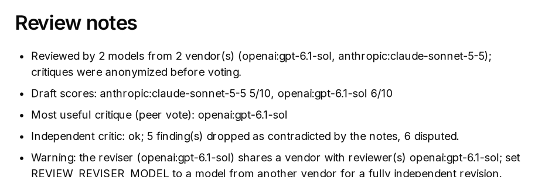
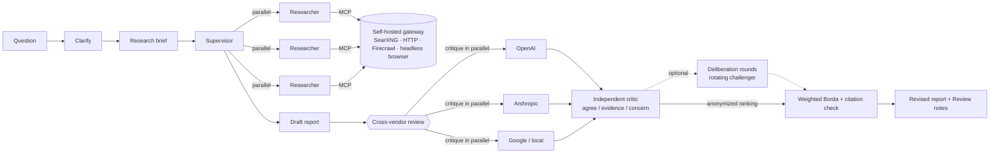

# Crossvet

[](https://github.com/j-zulick/crossvet/actions/workflows/ci.yml) [](https://github.com/j-zulick/crossvet/releases/latest) [](LICENSE) [](.python-version)

**Deep research whose reports are checked by models from several AI vendors before you read them, plus a benchmark that measures which model to use for each job in the pipeline.**

## TL;DR
- **What:** a deep-research agent (a fork of LangChain's Open Deep Research) that has every report reviewed by models from **different AI vendors** before you read it. Outcomes are decided by code, not by a model's say-so: a cited URL the research never read is flagged; evidence that overrules a finding must be a quote found verbatim in the notes; debate stops by rule, with a guard against agreement the notes don't back.
- **Why:** one model checking its own report shares its blind spots, and LLM judges favor their own output and confident wording. A mixed-vendor panel with evidence checks in code catches what one model misses (see [Design principles](#design-principles)).
- **Which model for which job:** `crossvet-bench` scores each role (planning, research, writing, review, critic, revision) with answer keys, not a judge model, and writes the best-quality or best-value models to `.env`.
- **Security:** every fetched page is checked in code for prompt injection (text aimed at the model, such as "ignore your instructions" or "recommend X") before any model reads it; flagged sources are listed in the Review notes, and claims resting only on them go to *Disputed*. `crossvet-scan` (also an MCP tool) runs the same check on any page. Threats, defenses and limits: [docs/SECURITY-MODEL.md](docs/SECURITY-MODEL.md).
- **Review any report:** `crossvet review report.md --sources …` checks a report from any tool against the files or URLs it should rest on ([how](docs/FEATURES.md#review-any-report-crossvet-review)).
- **Use it** from the CLI, a Python API, LangGraph Studio, Docker, or as an **MCP tool from Claude Code, Codex or Cursor** ([how](#use-it-from-claude-code-codex-or-cursor-mcp)).
- **Measured so far:** see [below](#measured-so-far), including what hasn't been measured yet.

Crossvet extends LangChain's [Open Deep Research](https://github.com/langchain-ai/open_deep_research) (MIT). A single model writing a research report will state unsupported claims with confidence. Crossvet adds a **cross-vendor review** stage: after the draft report is written,

1. reviewers from different vendors (e.g. OpenAI, Anthropic, Google, or a self-hosted model) critique it **independently and in parallel**, as typed objects;
2. the critiques are **anonymized and shuffled**, and every reviewer ranks them — combined with a **confidence-weighted Borda count**;
3. a **deterministic citation check** flags any URL the report cites that never appeared in the research notes;
4. an **independent critic** (always a different model from the finding's author) checks every reviewer finding against the research notes: *agree*, *disagree with evidence* (an exact quote, verified in code before it can overrule anything), or *disagree concern*. Contradicted findings are dropped; unresolved ones go to a **Disputed** section for a human;
5. optionally, reviewers **deliberate** for up to three rounds (`REVIEW_DELIBERATION_ROUNDS`): a rotating challenger contests findings and the author holds, revises or withdraws them. A change of position counts only with a passage from the research notes, verified in code; changes without one are ignored and flagged as possible sycophancy. Challengers label every finding AGREE, DISAGREE or BUILD_ON, and code stops deliberation early on consensus or a stable disagreement, with a guard against agreement the notes don't back (see [Early stopping](docs/FEATURES.md#early-stopping-in-deliberation)). Optionally, a **blind first pass** has every reviewer outline the answer from the notes before reading the draft, and grounded points the draft omits become feedback (see [Blind first pass](docs/FEATURES.md#blind-first-pass));
6. the report is revised with the top-ranked feedback and ends with **Review notes**: per-model scores, the peer-voted best critique, dissent, critic outcome, flagged citations, and any reviewer that failed.

**See it on a real run:** [docs/examples/jwst-mirror.md](docs/examples/jwst-mirror.md): an OpenAI + Claude panel scored the first draft 4/10; the revised report and its Review notes are reproduced unedited.





## Measured so far

Results are published only from real runs (protocol: [docs/EVALS.md](docs/EVALS.md)).

- **Every reviewer caught every planted error, but they differ in false alarms.** In the [Nov 17, 2026 role benchmark](docs/benchmarks/2026-11-17/) (four models from two vendors, six synthetic cases, $1.49), every model found all four planted errors (a wrong number, a citation to a source the research never read, an unsupported claim, an omitted finding) in every case. On drafts with nothing wrong, they raised 1.2 to 6.5 findings each. That gap is why Crossvet sends every finding to a critic from a different model, with evidence checked in code.
- **The critic separates true from false findings.** Critics scored 0.90 to 1.00 balanced accuracy at accepting the planted errors and rejecting findings the notes contradict (blanket agreement scores 0.5).
- **Small models were enough for most roles.** Claude Haiku 5.5 came within 0.03 of the best score in six of seven roles at 7 to 19 times lower cost per case. Most roles saturate on these cases, so harder cases are next ([caveats](docs/MODEL-SELECTION.md#results)).
- **Newer models, measured** (Nov 18 run, 7 models, $1.98 for the new jobs): GPT-6 Luna matched the top score in compression, report writing and revision at the lowest cost of any model, so v1.6.1 makes it the default for those roles. It is weak at planning and search, where GPT-6.1 Sol and gpt-5.4-mini stay ahead. Claude Opus 5.5 won no role ([details](docs/MODEL-SELECTION.md#results)).
- **Harder cases separate the models** (hard suite, Nov 18, 7 models, $2.19): with long notes, conflicting sources and subtler errors, scores spread out in planning (0.68–0.92), research and review. GPT-6.1 Sol was the only reviewer that caught every planted error with few false alarms, and gpt-5.4-mini missed a look-alike citation, so the example review panel now uses Sol ([details](docs/MODEL-SELECTION.md#november-18-2026-utc-hard-suite)).
- **Prompt injection** (Nov 18, 7 models, $3.60): a source carrying a planted instruction (override, hidden comment, cite-this-URL, role change). No model wrote the planted claim into a final report (0 of 55 inspectable reports), and every reviewer caught it when it was planted in a draft (56 of 56 across both suites). The exposure is in compression, which passed the instruction text on unflagged in 6 of 28 runs; the injection check's line raised the share that reported the source as suspect from 14 to 18 of 28. Harder forms (paraphrased, translated, split across sentences) got past the pattern check every time, and one of 28 reports adopted one; reviewers still caught every planted claim ([details](docs/benchmarks/2026-11-18-injection/)).
- **Jev support checks** (Nov 18, 28 review runs, $7.82 in model calls): in default mode Jev rejected 77–87% of the passages reviewers cited, because findings describe the draft and a source can't state that; asking about the reviewer's stated fact instead (`REVIEW_SUPPORT_CLAIM=fact`) cut it to 29%. Neither has been checked against an answer key yet ([details](docs/evals/2026-11-18-jev/)).
- **A live run:** on [the JWST example](docs/examples/jwst-mirror.md), an OpenAI + Claude panel scored the first draft 4/10; the revised report and its Review notes are reproduced unedited.
- **Review vs. no review, pilot:** 3 questions, one run each ([details](docs/evals/2026-11-17-pilot/)). Review cost $0.36 per report against $0.19 without it, and took 171 s against 100 s. The critic dropped 8 reviewer findings the notes contradict and listed 32 it couldn't confirm for a human. Review also caught a draft that a provider's content filter had cut off mid-sentence (panel score 3–4/10), which led to a fix: such reports are now written again or labelled incomplete.

  | Pilot, Nov 17, 2026 | No review | Review |
  |---|---|---|
  | Cost per report | $0.19 | $0.36 |
  | Time per report | 100 s | 171 s |
  | Findings dropped by the critic / listed for a human | — | 8 / 32 |
  | Draft score from the panel | — | 5.2 / 10 |

- **Not measured yet:** whether review makes reports more accurate end to end (that needs blind grading) compared with no review, and the effect of deliberation, early stopping, the blind pass, Jev checks and domain packs. These are listed as "not run" in [docs/EVALS.md](docs/EVALS.md), with how each will be measured. The first one is a single command: `uv run crossvet-compare --setups examples/compare/review-vs-none.toml --questions examples/compare/questions-15.txt --repeats 3`.

## Cost and API keys

Crossvet calls models through their APIs, so it needs API keys (or one OpenRouter key for most vendors, or local models for free). It does not drive consumer chat or coding subscriptions: it is a pipeline and a service, and those subscriptions are for interactive use. Every call's cost is real on OpenRouter and estimated from list prices elsewhere; Langfuse shows it per run, `crossvet-bench --dry-run` estimates a benchmark before you spend, and `--max-usd` caps it. In the [Nov 17 pilot](docs/evals/2026-11-17-pilot/), a report cost about $0.19 without review and $0.36 with a two-vendor panel, at v1.6.0's default models (token list prices; web search fees extra).

## Design principles

Each design choice answers a documented failure mode of using LLMs to judge LLM output: reviewers from different vendors, anonymized and shuffled critiques, a reviser outside the panel, evidence checked in code, and debate that stops when it stops helping. The table of principles, how Crossvet implements each one, and the papers behind them: [docs/DESIGN-PRINCIPLES.md](docs/DESIGN-PRINCIPLES.md). Trade-offs: [docs/DESIGN-DECISIONS.md](docs/DESIGN-DECISIONS.md).

## Features

| Feature | What it does |
|---|---|
| [Early stopping in deliberation](docs/FEATURES.md#early-stopping-in-deliberation) | Debate between reviewers stops by rule on consensus or a stable disagreement, with a guard against agreement the notes don't back (v1.1). |
| [Context, follow-ups and the Python API](docs/FEATURES.md#context-follow-ups-and-the-python-api) | Domain packs (SEO/GEO, marketing, real estate), follow-up questions answered from a run's own notes (`crossvet ask`), and `run` / `ask` in Python (v1.5). |
| [Support checks with Jev](docs/FEATURES.md#support-checks-with-jev) | A decision model scores whether each quoted passage supports the claim made from it; code still requires the verbatim quote first (v1.4). |
| [Blind first pass](docs/FEATURES.md#blind-first-pass) | Reviewers outline the answer from the notes before they read the draft; grounded points the draft omits become feedback (v1.2). |
| [Which model for which job](docs/FEATURES.md#which-model-for-which-job) | `crossvet-bench` scores each pipeline role with answer keys and writes the best-quality or best-value models to `.env` (v1.6). |
| [Grounded search on self-hosted infrastructure](docs/FEATURES.md#grounded-search-on-self-hosted-infrastructure) | Research through a self-hosted search gateway over MCP instead of a paid search API (v0.8, contract-tested). |
| [Durable runs from the command line](docs/FEATURES.md#durable-runs-from-the-command-line) | `crossvet run`, `resume` and `status`: every step checkpointed to SQLite or Postgres, with optional human approval before the report (v0.3). |
| [Two editions](docs/FEATURES.md#two-editions) | The LangGraph research graph and a LangChain Deep Agents edition, both with the same review (v0.6). |
| [Compare models](docs/FEATURES.md#compare-models) | `crossvet-compare` runs the same questions under different setups and records citations, critic outcomes, tokens and latency (v0.4). |
| [Run export and fine-tuning data](docs/FEATURES.md#run-export-and-fine-tuning-data) | JSONL run export and `crossvet-dataset` for MLX LoRA training data from your own runs (v0.2, v0.7). |

## Documentation
[Features](docs/FEATURES.md) · [Design principles](docs/DESIGN-PRINCIPLES.md) · [Architecture](docs/ARCHITECTURE.md) · [Design decisions](docs/DESIGN-DECISIONS.md) · [Model selection](docs/MODEL-SELECTION.md) · [Evaluations](docs/EVALS.md) · [Contributions and AI assistance](docs/CONTRIBUTIONS.md) · [Agent guide](AGENTS.md) · [Changelog](CHANGELOG.md) · [Security](SECURITY.md)

## Stack
Python 3.13 · uv · **LangGraph 1.2** (interrupts, SQLite / Postgres checkpointers) · LangChain 1.x (`init_chat_model`, any provider) · **OpenRouter** (`langchain-openrouter`: one key, most vendors, real per-call cost) · **Pydantic v2** typed outputs · **self-hosted models** via Ollama or any OpenAI-compatible server · **Deep Agents** (`deepagents`) edition · **Langfuse** tracing · **MCP** server · pytest · ruff · GitHub Actions (CodeQL, gitleaks, SBOM) · Docker Compose · **Agent Chat UI** (Next.js 16, React 19, Tailwind 4) in `web/`.

## Quickstart
Requires Python 3.11–3.13 (the repo pins 3.13 in `.python-version`; `uv` downloads it if needed). Newer Python versions may lack prebuilt packages for some dependencies.

```bash
scripts/quickstart.sh     # checks tools, installs, asks for keys (hidden), picks models your keys can use,
                          # tests each model with one tiny request, runs the setup check and a first research run
```
Or step by step:
```bash
uv sync
uv run crossvet-setup --check                        # writes .env: cross-vendor panel + independent reviser from available models
uv run python -m open_deep_research.doctor           # checks keys, reviewers, search; never prints key values
uv run crossvet-doctor --jev                         # same checker as a command; --jev asks Jev two known questions
uv run crossvet-try                                  # one run; saves report, review and a key-free share.md
uv run langgraph dev --config langgraph.local.json   # API on :2024, opens LangGraph Studio

# optional web UI
cd web && cp .env.example .env && pnpm install && pnpm dev   # http://localhost:3000
```

**Or with Docker** — one command for the API (both editions) and the web UI, bound to localhost:
```bash
cp .env.example .env            # add your keys
docker compose up --build       # API http://localhost:2024 · web UI http://localhost:3000
```

**Search:** `SEARCH_API=gateway` (with `RESEARCH_GATEWAY_URL` and `RESEARCH_GATEWAY_TOKEN`), `tavily` (with `TAVILY_API_KEY`), or `openai` / `anthropic` to use the model's built-in web search with no extra key (`crossvet-setup` picks this when no Tavily key is set). With built-in search, every source the search consulted is added to the research notes, so the citation check still works; the gateway and Tavily also capture each page's text for the critic to quote. **Combined search:** add `SEARCH_ALSO=openai` (or `anthropic`) to give researchers the model's built-in search next to the gateway or Tavily, so research continues if one source returns nothing; the researcher model must be from that vendor.

**Models:** every stage is configurable (`RESEARCH_MODEL`, `SUPERVISOR_MODEL` for orchestration, `RESEARCHER_MODEL`, `SUMMARIZATION_MODEL`, `COMPRESSION_MODEL`, `FINAL_REPORT_MODEL`), and so is every review role. Any setting takes a `provider:model` string: `openai:…`, `anthropic:…`, `google_genai:…`, `openrouter:<maker>/<model>` (with `OPENROUTER_API_KEY`), `ollama:<model>`, or `local:<model>` for any OpenAI-compatible server (llama.cpp, LM Studio, MLX, vLLM) at `LOCAL_LLM_BASE_URL`. Reviewers are set with `REVIEW_MODELS`. At least two reviewers must respond (quorum); failures are reported, not fatal. Set `REVIEW_REVISER_MODEL` to a model from a vendor that is *not* on the panel, so no lab grades and then rewrites its own work; Crossvet adds a warning to the Review notes when the reviser shares a vendor with a reviewer. Turn the stage off with `CROSS_VENDOR_REVIEW_ENABLED=false`.

### Choose your own models
Crossvet doesn't fix a vendor list: any model your keys can call can sit on the panel, revise, or run a stage. `crossvet-setup` only suggests.
```bash
uv run crossvet-setup --list-models openrouter --filter grok        # every id a provider offers (openai, anthropic, google_genai, openrouter, ollama, local)
uv run crossvet-setup --panel openrouter:x-ai/grok-4.7,anthropic:claude-opus-5-5,openrouter:z-ai/glm-5.3 --reviser google_genai:gemini-3.1-pro-preview
```
- **Your choice sticks.** Once `REVIEW_MODELS` is set, re-running setup keeps it and only checks it: names your key cannot call, a single-vendor panel, or a reviser that shares a vendor with the panel are reported. `--auto` re-picks; `--panel` replaces.
- **Wide vendor coverage through OpenRouter.** One `OPENROUTER_API_KEY` adds vendors such as xAI (Grok), Z.ai (GLM), Moonshot (Kimi), DeepSeek, Qwen, Mistral and Meta; the automatic pick takes the newest model per vendor not already on the panel. The vendor that counts for diversity is the model's maker (`openrouter:z-ai/glm-5` → `z-ai`).
- **Who hosts an OpenRouter model** (not which model runs): `OPENROUTER_PROVIDER_ORDER` (hosts to try first), `OPENROUTER_ALLOW_FALLBACKS=false` (only those hosts) and `OPENROUTER_DATA_COLLECTION=deny` (only hosts that don't store or train on prompts).
- **Spares and time limits.** `REVIEW_FALLBACK_MODELS` lists spare reviewers; when one fails, the next spare takes its place, preferring a vendor not already on the panel, and the Review notes say who replaced whom. `REVIEW_CALL_TIMEOUT` (seconds, 0 = off) abandons any single review call that hangs and handles it as a failure.

## Use it from Claude Code, Codex or Cursor (MCP)
`crossvet-mcp` is an MCP server (stdio) with two tools:
- `ask_model(model, prompt)` — ask any configured model, cloud or local;
- `compare_models(prompt, models?)` — ask several models in parallel; per-model failures are reported, never hidden.

```bash
claude mcp add crossvet -- uv --directory /path/to/crossvet run crossvet-mcp
```

## Tests
```bash
uv run pytest tests/unit -q     # offline: no API keys, no network
```
The offline suite covers the review stage end to end, every check that decides an outcome, both editions, the benchmark scoring and crash-and-resume. The full list: [docs/FEATURES.md](docs/FEATURES.md#what-the-tests-cover).

## Roadmap
- [x] **v0.1** — cross-vendor review, LangGraph 1.2 / LangChain 1.x upgrade, self-hosted model support, web UI, CI
- [x] **v0.2** — evidence-grounded critic and *Disputed* section, JSONL run export, MCP server (`ask_model`, `compare_models`)
- [x] **v0.3** — durable CLI runs (SQLite / Postgres checkpoints, resume), human approval before the final report, Langfuse tracing
- [x] **v0.4** — model comparison harness: any cloud or local model in any role, compared on citation support, critic outcomes, failures, latency and tokens
- [x] **v0.5** — deeper deliberation: rotating challenger, capped rebuttal rounds, position-change tracking with sycophancy flags
- [x] **v0.6** — Deep Agents edition (planning, sub-agents, virtual filesystem), compared against the LangGraph edition
- [x] **v0.7** — fine-tuning data path: run exports to MLX LoRA datasets for a self-hosted model (training and the before/after comparison run on your Mac)
- [x] **v0.8** — grounded search on self-hosted infrastructure (metasearch, layered page reading, saved evidence, SSRF protection) via MCP
- [x] **v1.0** — one-command Docker Compose, security scanning in CI, architecture and evaluation docs
- [x] **v1.1** — deliberation that stops when it stops helping: AGREE / DISAGREE / BUILD_ON labels, code-decided consensus and stable-disagreement stops, false-consensus guard, rounds saved in notes, compare and Langfuse
- [x] **v1.2** — blind first pass: reviewers outline the answer from the notes before reading the draft; grounded omissions become feedback
- [x] **v1.3** — your own models: `--panel` / `--reviser` / `--list-models`, a kept panel, GLM and Kimi via OpenRouter, OpenRouter host routing, spare reviewers, per-call time limits, `crossvet sessions`
- [x] **v1.4** — support checks with Jev: a decision model scores whether each quoted passage supports the claim made from it (position changes, AGREE / BUILD_ON, blind-pass points); `crossvet-doctor --jev`
- [x] **v1.5** — context and domain packs (SEO/GEO, marketing, real estate), follow-up questions answered from a run's notes (`crossvet ask`), a Python API (`run`, `ask`)
- [x] **v1.6** — model fit: any model in any role (official OpenRouter integration, real per-call cost, capability checks), separate orchestration and research models, and `crossvet-bench`, a per-role benchmark scored by answer keys with best-quality and best-value role maps
- [x] **v1.6.1** — newer models benchmarked (GPT-6 Luna becomes the default for the cheap roles), incomplete reports flagged in the Deep Agents edition, contributor docs
- [x] **v1.7** — prompt-injection check in code (fetched pages flagged before any model reads them, flagged sources in the Review notes), injection and hard benchmark suites, Jev support checks live-tested
- [x] **v1.8** — `crossvet-scan` (CLI and MCP tool) checks any page for prompt injection; `crossvet review` reviews any report against its sources; claims resting only on flagged sources go to *Disputed*

## My role and AI assistance

I designed Crossvet, set the scope of each release, chose what to adopt from other work and what to leave out, and reviewed every change. Most of the code, tests and documentation in this fork were written with Claude (Anthropic) through Claude Code under my direction; those commits carry a `Co-Authored-By: Claude` trailer. Details and how AI-written work is checked: [docs/CONTRIBUTIONS.md](docs/CONTRIBUTIONS.md).

## Release history

Crossvet was built between November 6 and 17, 2026 in a private repository, one tested version at a time, and every version was published together when the repository went public. Each release is the tagged commit that passed the full offline test suite, with its own notes in [docs/releases/](docs/releases/) and an entry in [CHANGELOG.md](CHANGELOG.md).

## Credits
Built on [Open Deep Research](https://github.com/langchain-ai/open_deep_research) and [Agent Chat UI](https://github.com/langchain-ai/agent-chat-ui) (both MIT). License notices are in [NOTICES.md](NOTICES.md); the original upstream README is in [docs/UPSTREAM-README.md](docs/UPSTREAM-README.md).

## License
MIT — see [LICENSE](LICENSE) (upstream) and [NOTICES.md](NOTICES.md).
