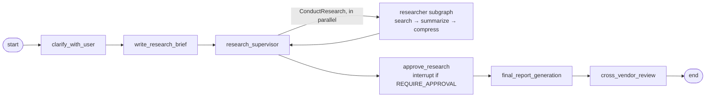
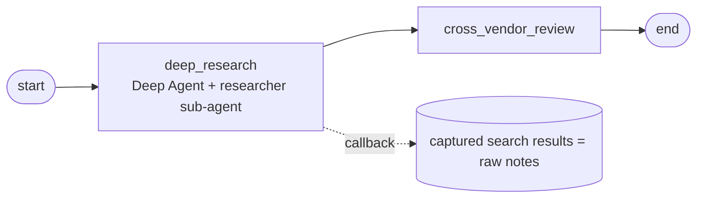

# Architecture

Crossvet is a LangGraph application with two research engines ("editions") that share one review stage, plus command-line tools around them. This page explains how the parts fit; [DESIGN-DECISIONS.md](DESIGN-DECISIONS.md) explains why.

## Components

| Path | Role |
|---|---|
| `src/open_deep_research/deep_researcher.py` | LangGraph edition (graph `deep_researcher`), extended from Open Deep Research |
| `src/open_deep_research/deep_agent.py` | Deep Agents edition (graph `deep_agent`) |
| `src/open_deep_research/cross_vendor_review.py` | Review node shared by both editions |
| `src/open_deep_research/deliberation.py` | Optional deliberation rounds inside the review |
| `src/open_deep_research/approval.py` | Optional human approval before the report |
| `src/open_deep_research/gateway_search.py` | Search through a self-hosted research gateway over MCP |
| `src/open_deep_research/cli.py` | `crossvet`: durable runs with checkpoints |
| `src/open_deep_research/compare.py` | `crossvet-compare`: setups × questions comparison |
| `src/open_deep_research/dataset.py` | `crossvet-dataset`: MLX LoRA datasets from run exports |
| `src/open_deep_research/mcp_server.py` | `crossvet-mcp`: models as MCP tools for coding agents |
| `src/open_deep_research/doctor.py` | Setup checker |
| `web/` | Agent Chat UI (Next.js) |

## The LangGraph edition

Researchers return compressed findings and keep **raw notes**: the search results they actually received. Raw notes are the ground truth every later check is measured against.

## The Deep Agents edition

The agent plans, delegates and writes `/report.md` in its virtual filesystem. A callback on the run records the output of every search tool call, including calls made inside sub-agents, so the review checks against retrieved text rather than the agent's own summary.

## The review stage

Input: the draft report, the raw notes and the research brief. Output: the revised report with *Review notes* (and a *Disputed* section when needed), a `review` summary in state, and optionally one JSON line in the run export.

1. **Critique.** Every model in `REVIEW_MODELS` critiques the draft in parallel as a typed `Critique`. Failed reviewers are recorded; fewer than two successes skips review (quorum).
2. **Anonymize.** Critiques are shuffled and relabelled `C1…Cn`.
3. **Critic.** For each critique, a different model judges every finding against the notes. `DISAGREE_EVIDENCE` must quote the notes; the quote is checked in code (`quote_in_notes`) before it can drop a finding. Unresolved findings go to *Disputed*.
4. **Deliberation** (optional, ≤ 3 rounds). A rotating challenger contests findings; the author maintains, revises or withdraws. Changes apply only when a quote is verified in the notes; otherwise they are ignored and counted as possible sycophancy.
5. **Vote.** Each successful reviewer ranks the anonymized critiques; ballots combine by confidence-weighted Borda count.
6. **Citation check.** URLs in the draft that never appear in the notes are flagged (`check_citations`), no model involved.
7. **Revise.** `REVIEW_REVISER_MODEL` (ideally a vendor outside the panel) applies the feedback in vote order plus the citation flags.

Every model call in steps 1–7 is isolated: one failure degrades the review and is reported; it never ends the run.

## Configuration

`Configuration` (Pydantic) is read in every node with `Configuration.from_runnable_config`. **Environment variables take precedence** over values passed in `configurable` (behaviour kept from upstream). `crossvet-compare` relies on this: it applies each setup through environment variables for the duration of a run.

## Persistence and tracing

- LangGraph server: in-memory (development server), or LangGraph Platform.
- `crossvet` CLI: `AsyncSqliteSaver` by default, `AsyncPostgresSaver` with `DATABASE_URL`; every super-step is checkpointed, so `resume` continues after a crash without repeating completed calls.
- Langfuse callbacks when its keys are set; LangSmith via the standard variables.

## Model routing

`build_reviewer(model)` resolves `provider:model` strings: `local:` → any OpenAI-compatible server at `LOCAL_LLM_BASE_URL`; `openrouter:` → OpenRouter; everything else → `init_chat_model` (OpenAI, Anthropic, Google, Ollama, Groq, DeepSeek, Bedrock…). `vendor_of()` maps each string to its vendor (OpenRouter models to their maker, local routes to `self-hosted`) for independence checks.

## Deployment

`docker compose up --build` runs the API (both graphs, port 2024) and the web UI (port 3000), bound to localhost. The API image runs as a non-root user and reads keys from `.env` at runtime; no key is baked into an image.
