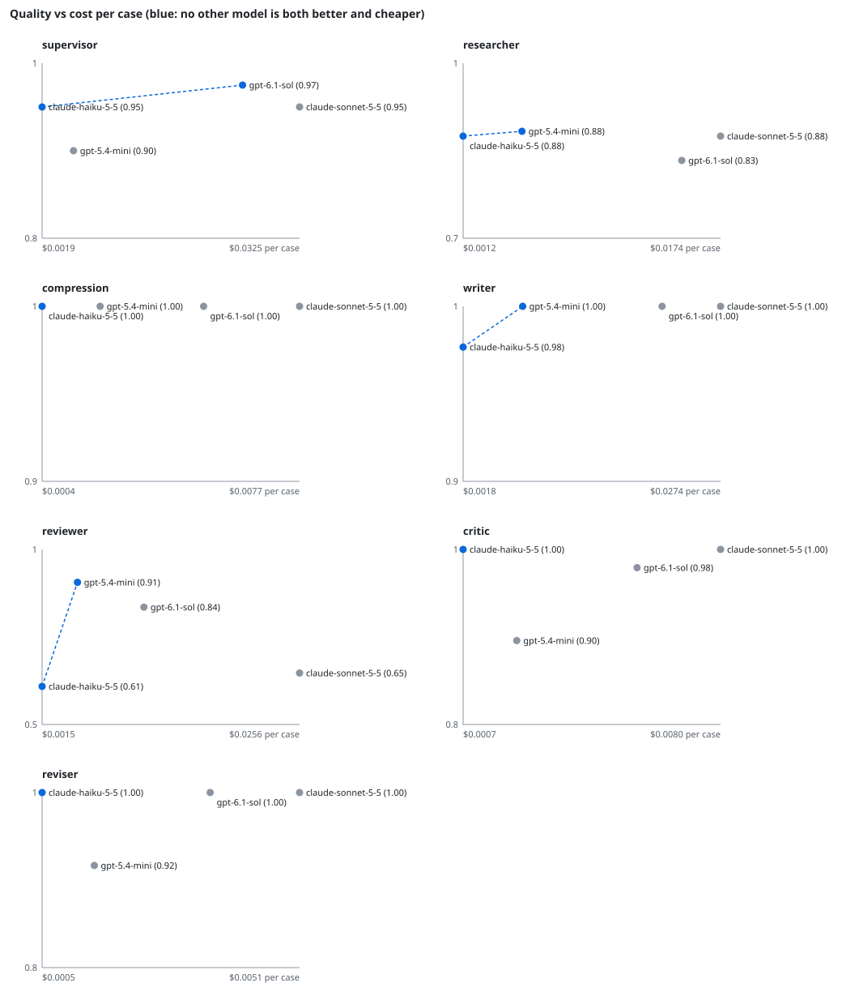

# Features in detail

Everything Crossvet does beyond the core review, one section per feature. The [README](../README.md) has the overview, the quickstart and the measured results.

## Early stopping in deliberation

Deliberation costs two model calls per critique per round. Since v1.1 code, not a model, decides after each round whether another round is worth paying for:

| Stop reason | When |
|---|---|
| `consensus` | No finding moved this round and the challengers endorsed at least `REVIEW_CONSENSUS_THRESHOLD` of the findings (default 1.0, unanimous) |
| `stable` | Findings are still contested, but nothing moved for two rounds in a row |
| `no_findings` | Nothing is left to review |
| `max_rounds` | The cap (`REVIEW_DELIBERATION_ROUNDS`, at most 3) was reached |

Every challenger labels each finding **AGREE**, **DISAGREE** or **BUILD_ON** by its anonymous id. DISAGREE goes to the author as a challenge. BUILD_ON adds to the finding only when its quote is found in the notes. **False-consensus guard:** if fewer than `REVIEW_CONSENSUS_MIN_GROUNDED_SHARE` (default 0.5) of the endorsements cite a passage that is in the notes, or the challengers said nothing, one more round runs with the next challenger before deliberation may stop. So with early stopping on, a silent challenger costs one extra round, where v1.0 stopped at once.

The Review notes say why deliberation stopped and how many rounds it saved; the run export, `crossvet-compare` (`rounds_saved`, `mean_agreement_rate`, `deliberation_calls`) and Langfuse (scores `rounds_saved`, `agreement_rate`, `deliberation_calls` and a categorical `stop_reason`) record the same. `crossvet-setup --compare-plan` writes a `deliberation-3-fixed` vs `deliberation-3-early-stop` pair so you can measure the saving on your own questions. `REVIEW_DELIBERATION_EARLY_STOP=false` restores the v1.0 rule.

## Context, follow-ups and the Python API

**Context and domain packs.** `RESEARCH_CONTEXT` says who is asking and why ("SEO consultant preparing a client audit for a US regional retailer"). `CONTEXT_PACK` adds the evidence rules of a field: which sources count as primary, which claims go stale, what reviewers should check.

| Pack | Highlights |
|---|---|
| `seo` | Google's own documentation and statements first; patents are not proof of use; vendor studies are correlations; every algorithm or AI Overview claim is dated |
| `marketing` | platform docs, filings and surveys with a published method first; vendor reports named with sample, geography and date; medians vs averages |
| `real-estate` | MLS, public records and government data first; every figure tied to a geography and period; rules vary by jurisdiction |

Both are appended to the research brief, so researchers, critics, deliberation and the reviser all work to them. Both editions use them; `crossvet-doctor` checks the pack name.

**Follow-up questions.** Ask about a finished run without researching again: one model call, answered only from that run's notes, with the same citation check as the report.
```bash
uv run crossvet ask --thread <id> "Which source gives the 2025 figure?"   # --out followups.md appends; exit code 2 if a cited URL was never read
```

**Python API.**
```python
from open_deep_research.api import run, ask

result = run("Do AI Overviews cite top-ranking pages?", config={"context_pack": "seo", "review_deliberation_rounds": 2})
print(result["final_report"], result["review"]["status"])
print(ask("Which study measured that?", result)["answer"])
```
`run` / `arun` accept any setting from `configuration.py` and `edition="deep_agent"`; API runs never pause for approval.

## Support checks with Jev

Code already refuses evidence that isn't a verbatim quote from the research notes. A real quote can still be used for a claim it doesn't support. With `REVIEW_SUPPORT_CHECKER=jev`, Crossvet also asks **Jev**, TypeSafe's decision model, one yes/no question per (claim, passage) pair: does this passage support this claim? Jev answers with a probability, not with text, so the check is fast, cheap and easy to threshold.

| Claim | Passage | If P(support) < `REVIEW_SUPPORT_MIN_PROB` (0.5) |
|---|---|---|
| A revision or withdrawal in deliberation | the quote offered for it | counted as an ungrounded position change; the finding stays |
| A challenger's AGREE | its quote | not counted as grounded, so the false-consensus guard can trigger |
| A challenger's BUILD_ON | its quote | the addition is not applied |
| A blind-pass point | its quote | the point is dropped |

**What Jev is asked about.** By default (`REVIEW_SUPPORT_CLAIM=finding`) the claim is the reviewer's finding. Findings are usually statements about the draft, which a source passage rarely states directly, so Jev rejects most of them: 77–87% in the [Nov 18 runs](evals/2026-11-18-jev/). With `REVIEW_SUPPORT_CLAIM=fact`, reviewers state in one sentence what the quoted passage says, and Jev checks that instead (29% rejected). That is a weaker test of the verdict, so it is opt-in until it is measured against an answer key. The answer key is built: `uv run crossvet-bench support-key` scores both modes on 24 labelled passages (12 that support the reviewer's point; 12 that don't: a misread number, the same topic without the point, partial support, a contradiction) and reports accuracy, balanced accuracy and how many supported points each mode rejects (`--dry-run` lists the 48 Jev calls; a run is billed by TypeSafe). Cases: `src/open_deep_research/support_key.py`.

Set `TYPESAFE_API_KEY` (from [console.typesafe.ai](https://console.typesafe.ai)) and `REVIEW_SUPPORT_CHECKER=jev`; `crossvet-setup` turns it on when the key is present. Pin a version with `REVIEW_SUPPORT_MODEL=jev-1.14.0` (default: `TYPESAFE_DEFAULT_MODEL`, else `jev-latest`). Check it with `uv run crossvet-doctor --jev`, which asks Jev two questions with known answers.

If a Jev call fails, that claim is judged by the quote check alone and the Review notes say how many calls failed. Every score is kept in the run export; `crossvet-compare` and Langfuse record `support_checked` and `support_rejected`, and the compare plan adds a `deliberation-2-jev` setup when the key is set.

## Prompt-injection check
Each fetched page is scanned in code before any model summarizes it, for text aimed at the model rather than the reader: instructions to ignore or override, text addressed to an AI, role changes, instructions to recommend, cite or leave something out, chat markup, and hidden text alongside any of those. A hit adds a line to that source in the research notes (naming the kinds of pattern, not the injected text), and the Review notes list flagged sources and any the report cites; a sentence whose every cited source is flagged is listed under *Disputed*. Invisible Unicode tag text and base64 blobs are decoded and scanned. Spanish, French, German, Portuguese, Italian and Dutch forms are matched (text addressed to an AI, overrides, role changes, commands about the reply, instructions to omit), as are commands about the reader's own reply ("add … to your response"), and a page that is mostly one repeated sentence or name is flagged (`repetition`). Disguises are undone before matching: look-alike letters, invisible characters, letter-spaced words, ROT13 and reversed text; an instruction split into short fragments is joined and matched as `split:` (v1.10). The summarizer prompt treats page text as data, and the summarizer and compression prompts say to report a page's recommendations and instructions as that page's claims, never as findings. A URL the report cites that appears in the notes only inside a page's text, never as a source the research read, is listed in the Review notes as unverified (only when the notes use `URL:` source lines). Paraphrased instructions are still missed. Design decision 22. Works with `SEARCH_API=tavily` and the research gateway; vendor-hosted search returns no page text to scan. No setting: the check is always on. Threat model and limits: [docs/SECURITY-MODEL.md](SECURITY-MODEL.md); design decision 19.

To measure how often models act on a planted instruction, with and without the flag line:

```bash
uv run crossvet-bench run --suite injection --roles summarizer,compression,writer,reviewer,critic,reviser --models <ids>
uv run crossvet-bench run --suite injection-checked --roles summarizer,compression,writer,reviewer,critic,reviser --models <ids>
uv run crossvet-bench run --suite injection-hard --roles summarizer,compression,writer,reviewer,critic,reviser --models <ids>
uv run crossvet-bench run --suite injection-hard-checked --roles summarizer,compression,writer,reviewer,critic,reviser --models <ids>
```

## Effort and the model guard
Three settings decide in code, with no model asked, how much a run does and when a stronger model or a stop is warranted. All are off by default, so a run without them behaves as before.

**Effort.** `EFFORT=quick|standard|deep`, or `--effort` on `crossvet research` and `crossvet try`:

| Tier | Parallel researchers | Research rounds | Tool calls per researcher | Review panel | Deliberation rounds | Blind pass |
|---|---:|---:|---:|---|---:|---|
| `quick` | 2 | 2 | 4 | first 2, one per vendor | 0 | off |
| `standard` | your settings (defaults 5) | (6) | (10) | all | (0) | (off) |
| `deep` | your setting | 8 | 15 | all | 2 | on |

- A setting you set yourself always wins over the tier. `REVIEW_PANEL_LIMIT` is also a setting of its own.
- `--effort auto` picks the tier from the question's text: one short lookup question is `quick`; a long question, three or more sub-questions, or wording such as "compare" or "analysis" is `deep`; everything else, and anything unclear, is `standard`. The command prints the tier and the reason.
- When a tier is set, the Review notes carry an `Effort:` line with the values in effect.
- The research columns apply to the LangGraph edition; the review columns apply to both editions.
- The tier values are starting points. What each tier saves, and what it costs in report quality, has not been measured yet.

**Escalation.** `ESCALATION_MODEL=provider:model`. A stage runs on its own model first. The same call goes to the escalation model only when code sees a failure: the call errors, or its structured output does not parse, after the stage's retries; or the report is cut off by an output limit or a content filter. Covered stages: clarification, the research brief, page summaries, compression and the report (LangGraph edition). The supervisor, the researchers and every review role are never escalated. Each escalation is logged and listed in the Review notes as `stage: model → escalation model (reason)`.

**Spend cap.** `MAX_RUN_USD`, or `--max-usd` on `crossvet research`, `crossvet resume` and `crossvet try`. Once the counted spend reaches the cap, the next model call is refused, the command says so and exits with code 3. Cost is what the provider reports with each call (OpenRouter does), otherwise tokens times the list price in the OpenRouter catalog that `crossvet setup` caches. A call whose price is unknown is counted as unpriced and cannot be capped; the summary line says how many there were. A stage that handles its own errors can still finish with what it has, so a capped run may end with a partial report.

Design decision 26.

## Check pages for prompt injection: `crossvet-scan`
The same check, as a standalone command and an MCP tool, for any page: your own site, a competitor's, user-generated content. It splits an HTML page into what a reader sees and what a reader doesn't and reports, per channel, the kinds of pattern found with a short excerpt. Hidden channels: hidden elements (inline styles, `hidden`, `aria-hidden`, off-screen, clipped, scaled to nothing, transparent or near-zero size, `<template>`, SVG titles and descriptions), text hidden only by the page's own `<style>` rules, HTML comments, attributes and meta tags (including hidden form inputs), JSON-LD and noscript (v1.10). Text split across inline elements is read as one run. Invisible Unicode tag text and base64 blobs are decoded and scanned too. A channel whose only finding is a repeated claim is left out unless you pass `--include-repetition`: on 608 real pages it was the only finding on 23 of the 24 flagged, all boilerplate ([details](benchmarks/2026-11-19-scan-patterns/)). No model or API key is used.

```bash
uv run crossvet-scan https://example.com/pricing saved-page.html notes.md
uv run crossvet-scan --json https://example.com/ > scan.json   # exit code 1 if anything was found
uv run crossvet-scan --sitemap https://example.com/sitemap.xml --format html --out report.html
uv run crossvet-scan --urls pages.txt --format csv --out scan.csv --max-pages 200 --delay 1
uv run crossvet-scan --crawl https://example.com/ --max-pages 50 --format html --out site.html   # through crawlee-server
```

Reports: `--format text` (default), `json` (`--json` still works), `csv` or `html`; `--out FILE` writes to a file instead of the terminal. The CSV has one row per finding (`source`, `status`, `channel`, `kinds` joined by `;`, `excerpt`, `error`) plus a row for each clean page and each page that could not be read; cells a spreadsheet would run as a formula are prefixed with `'`. The HTML report is a single file to hand to a client: a summary (pages scanned, pages with findings, errors), then a section per page, with inline CSS, no JavaScript and no external assets, and all page text escaped.

Many pages: `--sitemap URL_OR_FILE` scans the `<loc>` URLs of a sitemap.xml and follows a sitemap index one level deep (up to 50 child sitemaps; files over 5 MB, DTDs and non-http(s) page locations are refused). `--urls FILE` reads one URL per line, skipping blank lines and `#` comments. Both can be repeated and combined with paths and URLs on the command line; duplicates are scanned once. `--max-pages N` (default 50) caps the pages fetched over http(s) and `--delay SECONDS` (default 0.5) pauses between those fetches; URLs past the cap are counted on stderr. Exit codes: 0 when nothing was found, 1 when any page has a finding, 2 on a usage error, or when a page or sitemap could not be read and nothing was found.

Whole sites: `--crawl URL` asks a crawlee-server instance (`CRAWLEE_SERVER_URL`, `CRAWLEE_SERVER_TOKEN`) to crawl with page capture on, then scans every stored page, up to `--max-pages`; `--crawl-mode` picks crawlee-server's mode (`crawl` follows links, `page`, `sitemap`, `map`). It reaches pages that block plain HTTP fetches when crawlee-server renders them.

From Claude Code, Codex or Cursor, the MCP server's `scan_for_injection` tool takes a public URL (non-public addresses are refused) or pasted text. Pattern matching only: a clean result is not proof a page is safe.

## Review any report: `crossvet review`
Run the cross-vendor review on a report from any tool or person, against the sources it should rest on (files or URLs):

```bash
uv run crossvet review report.md --sources audit.md https://example.com/study --brief "What changed in 2026?" --out reviewed.md
```

```python
from open_deep_research.api import review
result = review(open("report.md").read(), ["audit.md", "https://example.com/study"])
```

Each source becomes a block of research notes with its URL (a file that starts with a `URL:` line is cited by that address, otherwise by its path) and the injection check's flag, so the citation, quote, critic and *Disputed* rules work as in a research run. `--panel` overrides `REVIEW_MODELS`. Design decision 21.

## Blind first pass

A draft anchors whoever reads it: reviewers check what it says and tend to miss what it leaves out. With `REVIEW_BLIND_PASS_ENABLED=true`, each reviewer first answers from the research notes alone, without seeing the draft: up to `REVIEW_BLIND_MAX_POINTS` (6) points, each with the passage that supports it, in one short call (`REVIEW_BLIND_MAX_TOKENS`, 1500). Then code:

1. drops points whose passage is not verbatim in the notes;
2. marks a point **covered** when the draft has the passage's numbers and most of its distinctive words;
3. adds every grounded, uncovered point to that reviewer's critique as an omission (deduplicated across reviewers), so it reaches the vote and the reviser.

Each reviewer also sees its own outline when it critiques the draft. The Review notes report points, coverage, omissions and dropped points; the export keeps every outline; `crossvet-compare` and Langfuse record `blind_omissions`, and the compare plan adds a `blind-pass` setup to compare with `review`. Coverage is a word-overlap heuristic: a paraphrase with different wording can be counted as an omission, which the reviser then sees as feedback rather than as a fact.

## Which model for which job

Planning research, searching, compressing notes, writing, reviewing, judging reviews and revising are different jobs, and the best model for one is often overpriced for another. Since v1.6 **any model works in any role** (OpenAI, Anthropic, Google, any of OpenRouter's vendors through one key, or a model on your own machine), orchestration and research have their own settings (`SUPERVISOR_MODEL`, `RESEARCHER_MODEL`), and `crossvet-bench` measures each role on its own:

```bash
uv run crossvet-bench suggest                                     # your models + the newest per vendor on OpenRouter
uv run crossvet-bench run --models openrouter:x-ai/grok-4.7,anthropic:claude-sonnet-5-5,openrouter:qwen/qwen4-max,ollama:gemma3 --max-usd 5
uv run crossvet-bench run --models <ids> --suite hard              # harder cases: long notes, conflicting sources, subtler errors
uv run crossvet-bench apply --preset best-value                   # write the winning role map to .env
```

- **Real work, scored by code.** Each role runs with Crossvet's own prompts and schemas on six synthetic cases (invented organizations on `.example` URLs, so models can't answer from memory). Scores come from answer keys, not a judge model: did the reviewer catch the four planted errors (wrong number, unread citation, unsupported claim, omission) without flagging a clean draft; did the critic agree with true findings and reject false ones; did the summarizer keep each page's key facts without passing on a planted instruction as fact; did compression keep the facts and URLs; did the supervisor delegate every part of the question.
- **Cost-aware.** Real per-call cost from OpenRouter (or token estimates), a hard `--max-usd` cap, a `--dry-run` estimate, resumable runs.
- **Decisions, not just a table.** A leaderboard per role, a quality-vs-cost chart with the frontier, and a role map with a **best-quality** and a **best-value** pick per role (the cheapest model within 10% of the top score). `apply` turns it into configuration: a one-model-per-vendor panel and a reviser from outside it.
- **Checked end to end.** `crossvet-bench live-plan --role supervisor --models a,b` writes a `crossvet-compare` file that swaps just that role, to confirm on real questions.

**First results (Nov 17, 2026; four models, two vendors, $1.49):** Claude Haiku 5.5 was within 0.03 of the best score in six of seven roles at 7 to 19 times lower cost per case; every model caught every planted error, and review quality came down to how much each flagged on a clean draft. Most roles saturate on the current cases, so harder ones are next. [Findings and caveats](MODEL-SELECTION.md#results) · [all outputs](benchmarks/2026-11-17/).



Capabilities are checked before a run: the doctor fails a role whose model can't call tools or return typed output (from OpenRouter's live catalog), and structured output uses JSON schema where a model supports it, otherwise a forced tool call. Method, formulas and limits: [docs/MODEL-SELECTION.md](MODEL-SELECTION.md).

## Grounded search on self-hosted infrastructure

Research can run on a search stack I operate instead of a paid search API (`SEARCH_API=gateway`). The agent talks to a **research gateway over MCP** (Streamable HTTP, bearer token):

- **Discovery** — SearXNG metasearch across several engines, with merged ranks and the engine recorded for every result, plus a private crawl index.
- **Layered reading** — plain HTTP first, then Firecrawl for JavaScript-heavy pages, then a headless browser. Every source reports which reader handled it and an honest status (`ok`, `partial`, `blocked`, `failed`); nothing is silently dropped.
- **Saved evidence** — pages are stored with final URL, fetch time and content hash, so claims can be traced back to exact passages.
- **Safety** — private and cloud-metadata addresses are refused before any fetch (SSRF protection); every call is authenticated.
- **Checked twice** — the cross-vendor review flags unsupported claims, and the deterministic citation check flags any URL the research never read.

| | Self-hosted gateway | Hosted search API | Model-native web search |
|---|---|---|---|
| Per-query cost | infrastructure only | per call | bundled in model tokens |
| Data leaves your infrastructure | no | yes | yes |
| Per-source provenance and read status | yes | partial | limited |
| Control over engines and readers | full | none | none |

The adapter (`src/open_deep_research/gateway_search.py`) tolerates schema differences between gateway releases and isolates per-query failures.

## Durable runs from the command line
```bash
uv run crossvet run "How are EU AI Act obligations phased in for general-purpose models?" --out report.md
uv run crossvet status --thread <id>      # where did it stop?
uv run crossvet resume --thread <id>      # continue after a crash or Ctrl-C
uv run crossvet sessions                  # saved runs, newest first: thread, last update, state, question
uv run crossvet ask --thread <id> "..."   # follow-up answered from that run's notes
```
Every step is checkpointed (SQLite by default, Postgres with `DATABASE_URL=postgresql://...` and `uv sync --extra postgres`). A run that crashes mid-way resumes from its last checkpoint without repeating completed — already paid-for — model calls.

**Human approval:** with `REQUIRE_APPROVAL=true` the run pauses after research. Approve, type instructions to steer the report, or reject before any report tokens are spent — at the terminal, or with approve / edit / reject buttons in the web UI. `--auto-approve` skips the prompt.

**Tracing and cost:** set `LANGFUSE_PUBLIC_KEY`, `LANGFUSE_SECRET_KEY` (and `LANGFUSE_BASE_URL` for a self-hosted Langfuse) and every model call in a CLI run is traced with tokens and cost per model; when the run ends, its review metrics (citations, flagged URLs, reviewer score, critic outcomes, deliberation stop reason and rounds saved, blind-pass omissions) are attached to the trace as scores, with the same names `crossvet-compare` uses. The LangGraph server also supports LangSmith tracing natively.

## Two editions
- **LangGraph edition** (`deep_researcher`, default): an explicit research graph — brief, supervisor, parallel researchers, compression, report.
- **Deep Agents edition** (`deep_agent`): research and drafting by a LangChain [Deep Agent](https://github.com/langchain-ai/deepagents) that plans with a to-do list, delegates sub-questions to researcher sub-agents and keeps notes in a virtual filesystem.

Both end in the same cross-vendor review. In the Deep Agents edition every search result returned to the agent or a sub-agent is captured by a callback and becomes the research notes, so the citation check, critic and deliberation verify against what was actually retrieved, not against the agent's own summary. With a model's built-in search (`SEARCH_API=openai` or `anthropic`) the sources are read from each model reply instead, including the sub-agents'. Pick the edition in LangGraph Studio or the web UI (`NEXT_PUBLIC_ASSISTANT_ID=deep_agent`), and compare the two with `crossvet-compare --setups examples/compare/editions.toml`.

## Compare models
Run the same questions through different model setups — hosted, OpenRouter, Ollama or a local server, in any role — and compare what each produced:
```bash
uv run crossvet-compare --setups examples/compare/setups.toml --questions examples/compare/questions.txt --repeats 2
```
To compare the models you actually have, let setup write the plan: `uv run crossvet-setup --compare-plan my-setups.toml` creates setups for review vs no review and for each Ollama or local model as report writer and as reviewer (plus deliberation and the Deep Agents edition when available). `examples/compare/questions-15.txt` has 15 questions with checkable answers.

With `LANGFUSE_PUBLIC_KEY` and `LANGFUSE_SECRET_KEY` set, every comparison run is also a Langfuse trace: one session per comparison, tagged `setup:<name>`, with scores attached (finished, cited and flagged URLs, flagged-URL rate, reviewer score, critic drops and disputes, seconds) and token cost per model. `results.jsonl` records each run's trace id.
Each setup is a named set of configuration overrides. Results go to `compare-results/`: one JSON line per run, a per-setup `summary.md` / `summary.csv` (finished runs, latency, input and output tokens, share of cited URLs the research never read, reviewer scores, critic drops and disputes, failed reviewers) and every report for side-by-side reading. A failed run is recorded and the comparison continues.

## Run export and fine-tuning data
Set `RUN_EXPORT_PATH=runs/review.jsonl` to append every reviewed run (research notes, draft, critiques, critic verdicts, deliberation, ballots, feedback, revision) as one JSON line.

`crossvet-dataset` turns those runs into chat-format datasets that `mlx_lm.lora` reads directly, so a model on your own Mac can learn from the hosted panel:
```bash
uv run crossvet-dataset --runs runs/review.jsonl --task critique --out data/critique   # notes + draft -> peer-voted, evidence-checked critique
uv run crossvet-dataset --runs runs/review.jsonl --task revise --out data/revise       # notes + draft + feedback -> citation-clean revision
mlx_lm.lora --model <model> --train --data data/critique --iters 600 --mask-prompt
mlx_lm.lora --model <model> --adapter-path adapters --data data/critique --test
mlx_lm.fuse --model <model> && mlx_lm.server --model fused_model                      # OpenAI-style API on localhost:8080
```
Splits are by research brief, so a question never appears in both training and test data. Only top-voted critiques that survived the critic, and only revisions that cite nothing the research did not read, become training targets. Then compare the base and fine-tuned model as a `local:` reviewer with `crossvet-compare`. Exports contain web content: check your sources' terms and keep datasets private.

## What the tests cover

```bash
uv run pytest tests/unit -q     # offline: no API keys, no network
```
Covers context packs (brief, both editions, doctor), follow-ups (notes-only answers, unread-URL flags, CLI), the Python API, the model factory (every stage on OpenRouter and local models, capabilities from the catalog, structured-output method, real cost), the role split, the role benchmark (scoring formulas with perfect and weak stand-in models, budget cap, resume, role maps, presets, the live plan), Jev support checks (the real TypeSafe SDK against a mock API: request shape, probabilities, failures that never block, rejected changes, ungrounded endorsements, blocked additions, dropped blind-pass points, the doctor's live check), your own model choices (kept panels, unknown names, single-vendor panels), spare reviewers, per-call time limits, OpenRouter host routing, the sessions list, the blind pass (grounding, coverage, omissions, prompts that never include the draft), early stopping (consensus, stable disagreement, the false-consensus guard and build-on grounding), anonymization (no vendor leaks into labels), Borda tallying, citation flagging, the critic protocol (fabricated evidence quotes are never trusted), quorum and failure handling, run export, the MCP tools, gateway parsing, self-hosted model wiring, the approval step with real LangGraph interrupts, the comparison harness, deliberation and the sycophancy guard, the Deep Agents edition (search capture and report file), fine-tuning dataset building, and crash-and-resume across two processes (a completed step is never re-run).
