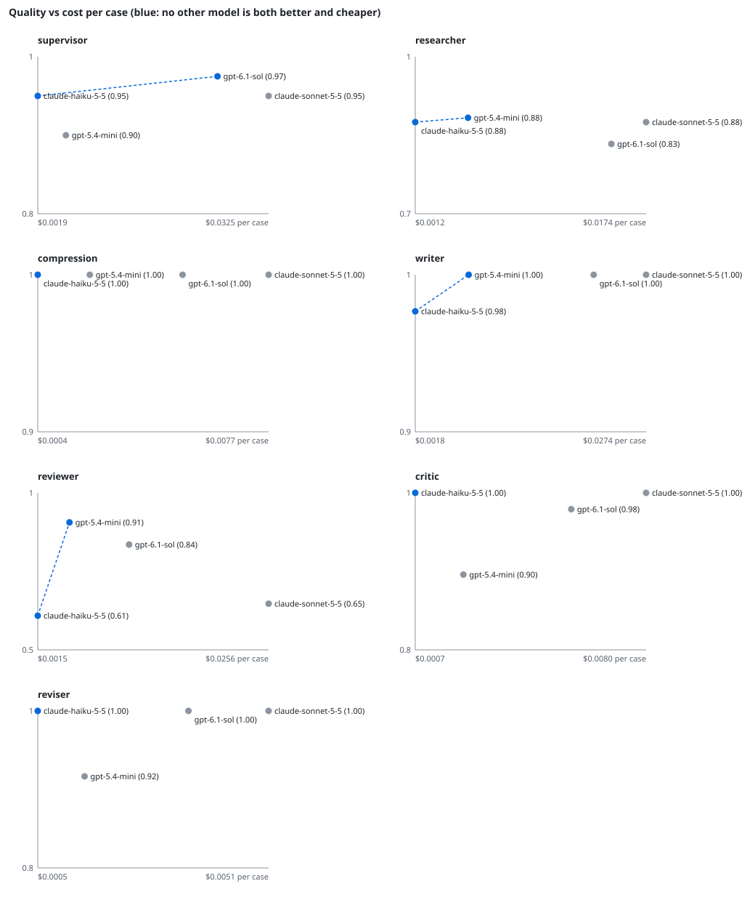

# Model fit benchmark, November 17, 2026

First published run of `crossvet-bench` (v1.6).

| | |
|---|---|
| Date | 2026-11-17 |
| Models | `openai:gpt-6.1-sol`, `openai:gpt-5.4-mini`, `anthropic:claude-sonnet-5-5`, `anthropic:claude-haiku-5-5` (called through each vendor's own API) |
| Roles | orchestration, research, compression, report writing, review, critic, revision |
| Cases | all 6 synthetic cases, 1 repeat (168 jobs, 0 failures) |
| Cost | $1.49 in total, estimated from tokens and each model's list price on OpenRouter (Anthropic's own list price for Haiku 5.5 matches: $0.10 / $0.50 per million tokens) |
| Command | `uv run crossvet-bench run --models openai:gpt-6.1-sol,openai:gpt-5.4-mini,anthropic:claude-sonnet-5-5,anthropic:claude-haiku-5-5 --max-usd 4` |

Files: [leaderboard.md](leaderboard.md) (tables), [quality-vs-cost.svg](quality-vs-cost.svg) (chart), [role-map.json](role-map.json) (recommended models per role), [leaderboard.csv](leaderboard.csv), and [results.jsonl](results.jsonl): every job with its metrics, tokens, cost and what the model said, so any score can be checked.

Findings and caveats: [docs/MODEL-SELECTION.md](../../MODEL-SELECTION.md#results).

