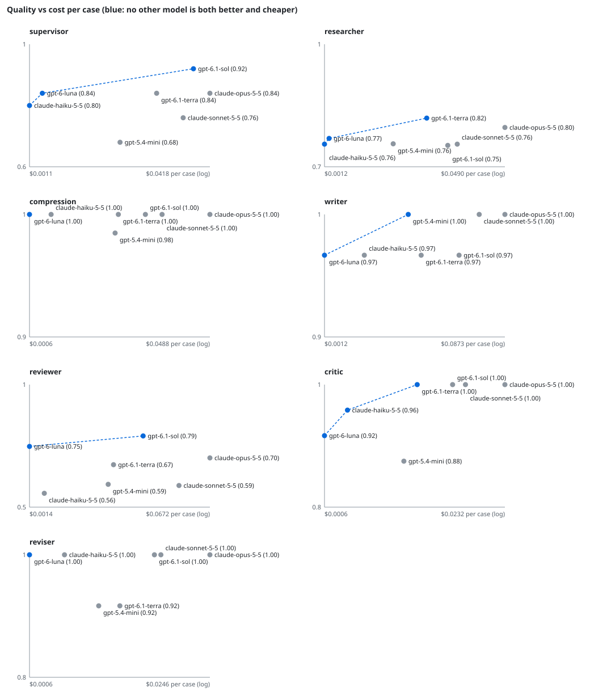

# Model fit benchmark, hard suite, November 18, 2026 (UTC)

The first run of the hard suite (`crossvet-bench run --suite hard`). On the standard cases most roles score 1.00 for every model, so those cases can't tell models apart in those roles. The three hard cases are built to:

- **Bury the answer.** 11 sources per case, several about other years, regions or products.
- **Make sources disagree.** A vendor blog, press release or agency case study conflicts with the primary source, and the clean report resolves the conflict.
- **Plant subtler errors:**
  - a digit-swapped number (27.1% → 21.7%, 9.6% → 6.9%, 7% → 17%);
  - an unread source whose title imitates a real one;
  - a causal claim the notes argue against;
  - a dropped caveat, the one that resolves the conflict.
- **Make false findings look plausible,** backed by a distractor source.

| | |
|---|---|
| Date | 2026-11-18 (UTC; the evening of November 17 in New York) |
| Models | `openai:gpt-6.1-sol`, `openai:gpt-6.1-terra`, `openai:gpt-6-luna`, `openai:gpt-5.4-mini`, `anthropic:claude-opus-5-5`, `anthropic:claude-sonnet-5-5`, `anthropic:claude-haiku-5-5`, each through its vendor's own API |
| Cases | `hard-apparel-returns`, `hard-transit-fare-cap`, `hard-local-reviews`; 1 repeat; 147 jobs, 0 failures |
| Cost | $2.19 for the final results, estimated from tokens and list prices (the same `--price` values as the [Nov 18 standard run](../2026-11-18/)). About $0.40 more went on a re-run of the review and revision roles after an answer-key fix: the first key required a caveat's exact wording, and every reviser had restored the caveat in its own words. |
| Command | `uv run crossvet-bench run --suite hard --models … --price … --max-usd 6` |

Files:
- [leaderboard.md](leaderboard.md): the tables;
- [quality-vs-cost.svg](quality-vs-cost.svg): the chart;
- [role-map.json](role-map.json): recommended models per role;
- [leaderboard.csv](leaderboard.csv), [leaderboard.json](leaderboard.json);
- [results.jsonl](results.jsonl): every job with its metrics, tokens, cost and what the model said.

Findings and caveats: [docs/MODEL-SELECTION.md](../../MODEL-SELECTION.md#november-18-2026-utc-hard-suite).

