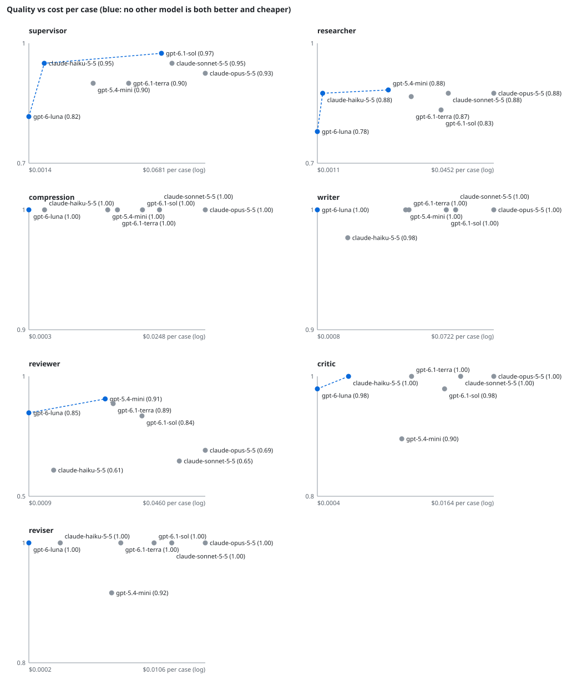

# Model fit benchmark, November 18, 2026 (UTC)

Second published run of `crossvet-bench`. It adds three newer models to the [first run](../2026-11-17/) and reuses that run's results for the four models it already covered. The bench resumes from earlier results, so the same jobs are not paid for twice.

| | |
|---|---|
| Date | 2026-11-18 (UTC; the evening of November 17 in New York) |
| New models | `openai:gpt-6-luna`, `openai:gpt-6.1-terra`, `anthropic:claude-opus-5-5` |
| Carried over | `openai:gpt-6.1-sol`, `openai:gpt-5.4-mini`, `anthropic:claude-sonnet-5-5`, `anthropic:claude-haiku-5-5` (168 jobs from the November 17 run) |
| Roles | orchestration, research, compression, report writing, review, critic, revision |
| Cases | all 6 synthetic cases, 1 repeat: 294 jobs, 0 failures |
| Cost | $1.98 for the 126 new jobs ($3.47 including the carried-over run). Estimated from tokens and list prices in USD per million input / output tokens: GPT-6 Luna $0.10 / $0.50, GPT-6.1 Terra $1 / $5, Claude Opus 5.5 $4 / $20 (and, for the carried-over models, the prices recorded in the first run) |
| Command | `uv run crossvet-bench run --models openai:gpt-6-luna,openai:gpt-6.1-terra,anthropic:claude-opus-5-5,openai:gpt-6.1-sol,openai:gpt-5.4-mini,anthropic:claude-sonnet-5-5,anthropic:claude-haiku-5-5 --price … --max-usd 6`, resumed from the first run's `results.jsonl` |

Files:
- [leaderboard.md](leaderboard.md): the tables;
- [quality-vs-cost.svg](quality-vs-cost.svg): the chart;
- [role-map.json](role-map.json): recommended models per role;
- [leaderboard.csv](leaderboard.csv), [leaderboard.json](leaderboard.json);
- [results.jsonl](results.jsonl): every job with its metrics, tokens, cost and what the model said.

Findings and caveats: [docs/MODEL-SELECTION.md](../../MODEL-SELECTION.md#results).

